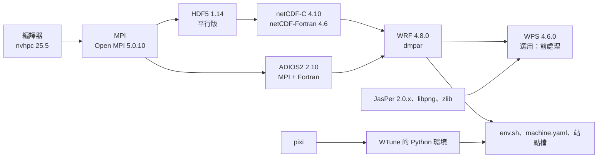

# 附錄：建 WTune 需要的前置環境（以 f1-arm 為例）

WTune 不編 WRF，也不裝函式庫，但它假設機器上已經有一套能跑的 WRF 環境。這頁從零開始，說明要準備哪些東西、各自怎麼建，用 f1-arm（aarch64 Grace、每節點 144 核、nvhpc 25.5）當實例。換機器時照同樣的順序，把路徑和編譯器換掉即可。

## 需要哪些東西



| 元件 | 用途 | WTune 必要嗎 |
|---|---|---|
| Slurm | 送量測、執行、後處理的 job | 必要 |
| Fortran／C 編譯器、MPI | 編 WRF 與函式庫 | 必要 |
| HDF5、netCDF | WRF 的 netCDF 輸入輸出 | 必要 |
| ADIOS2 2.10（MPI + Fortran） | WTune 預設的 I/O 格式（`io_form = 14`） | 必要 |
| WRF（dmpar，帶 ADIOS2） | 被調校、被執行的模式 | 必要 |
| WPS，加上可讀 GRIB2 的 ungrib | 前處理、`predict-rebuild` | 選用 |
| pixi | 裝 WTune 的 Python 環境 | 必要 |

## 0. 先記下機器的樣子

| 項目 | f1-arm 的值 | 怎麼查 |
|---|---|---|
| 每節點核心數、NUMA | 144 核、2 個 NUMA | `lscpu` |
| 計算節點能不能上網 | **不能**；只有登入節點 `nlgn01` 可以 | 在 job 裡 `curl` 一個網址 |
| partition 與限制 | `arm144`、`arm576`、`arm1440`，依節點數分層 | `sacctmgr show qos` |
| 家目錄配額 | GPFS，soft 100G | `mmlsquota` |

計算節點不能上網，所以所有要下載的東西（Spack 原始碼包、WRF／WPS 原始碼、觀測資料）都要先在登入節點準備好，編譯再送到計算節點跑。

## 1. 編譯器

f1-arm 用系統的 nvhpc 25.5：

```bash
export PATH=/pkg_arm/arm/compiler/nvhpc/25.5/Linux_aarch64/25.5/compilers/bin:$PATH
nvfortran --version
```

## 2. 函式庫（Spack）

用一個 Spack 環境把 MPI、HDF5、netCDF、ADIOS2 裝在一起，再建一個 view，讓 `NETCDF`、`HDF5`、`ADIOS2` 都指到同一個地方。

```yaml
# ~/wrf-env/nvhpc-arm/spack-env/spack.yaml（只列 specs 與路徑）
spack:
  specs:
  - openmpi@5.0.10 %nvhpc@25.5
  - netcdf-fortran@4.6.2 %nvhpc@25.5 ^hdf5@1.14.6+fortran+hl+mpi ^netcdf-c@4.10.0~blosc~dap+mpi~szip~zstd ^openmpi@5.0.10
  - adios2@2.10.2 +mpi +fortran ~python ~hdf5 %nvhpc@25.5 ^openmpi@5.0.10
  view: $HOME/wrf-stack/nvhpc-arm
  config:
    install_tree:
      root: $HOME/wrf-env/nvhpc-arm/store
  mirrors:
    wrf-local: file://$HOME/wrf-env/nvhpc-arm/mirror
```

```bash
source ~/spack/share/spack/setup-env.sh
E=~/wrf-env/nvhpc-arm/spack-env
spack -e $E concretize -f                                         # 每次改 spack.yaml 都要
spack -e $E mirror create -d ~/wrf-env/nvhpc-arm/mirror --all     # 登入節點：下載原始碼
sbatch -A <你的計畫代號> -p arm144 -N 1 -c 72 -t 4:00:00 \
       --wrap "source ~/spack/share/spack/setup-env.sh; spack -e $E install"   # 計算節點：編
```

f1-arm 上要注意：

- **Spack 自己的 bootstrap 工具編不出來。** patch、libtool、numactl、cmake 都失敗：nvc 和 GNU patch 不相容，GCC 的 assembler 不接受 Spack 推出的 `-march`。這幾個要在 Spack 外用 GCC 先編好，再登記成 external。
- **Slurm 的 `COMPLETED 0:0` 不代表裝成功。** 要確認 view 裡真的有 `mpif90`、`nc-config`、`nf-config`、`h5pfc`。
- **這個 Open MPI 沒有 UCX。** 跨節點走 TCP，所以站點檔要設 `OMPI_MCA_btl_tcp_if_include` 指到 InfiniBand 的 IP 網段，不然會走 1 Gb 的管理網。

## 3. WRF

```bash
# 登入節點：抓原始碼（含 submodule，計算節點抓不到）
mkdir -p ~/wrf-env/nvhpc-arm/wrf/vanilla-v480-adios2-dmpar && cd $_
git clone --depth 1 --recurse-submodules --branch v4.8.0 https://github.com/wrf-model/WRF.git
```

在計算節點上的 sbatch 裡：

```bash
V=$HOME/wrf-stack/nvhpc-arm
export PATH=/pkg_arm/arm/compiler/nvhpc/25.5/Linux_aarch64/25.5/compilers/bin:$V/bin:$PATH
export NETCDF=$V HDF5=$V ADIOS2=$V
export PNETCDF=                       # 一定要明確設空：沒有 PnetCDF
ulimit -s unlimited
cd ~/wrf-env/nvhpc-arm/wrf/vanilla-v480-adios2-dmpar/WRF
printf '19\n1\n' | ./configure        # 19 = NVHPC (nvfortran/nvc) dmpar；1 = basic nesting
grep -q DADIOS2 configure.wrf         # WRF 看到 ADIOS2 環境變數會自動打開
./compile -j 8 em_real > compile.log 2>&1
```

- `-j 20` 會 OOM，Fortran module 的相依順序也會亂掉。`-j 8` 約 20 分鐘編完。
- 中途失敗時不要 `./clean -a`，直接再跑一次 `./compile`。
- 驗證：`main/wrf.exe` 和 `main/real.exe` 都存在，`ldd main/wrf.exe | grep "not found"` 沒有輸出。

## 4. WPS（選用）

WPS 4.6.0 的 configure 選單沒有 aarch64 加 NVHPC 的選項，要自己準備 `configure.wps`。要讀 GFS 這類 GRIB2 資料，還要另外三個 C 函式庫。

**4a. GRIB2 函式庫：另開一個 Spack 環境**

另開環境，WRF 那套就不必重新 concretize：

```yaml
# ~/wrf-env/nvhpc-arm/wps-env/spack.yaml
spack:
  specs:
  - jasper@2.0.32 ~jpeg %gcc@11.4.1
  - libpng %gcc@11.4.1
  - zlib %gcc@11.4.1
  view: $HOME/wrf-stack/wps-libs
```

!!! warning "JasPer 一定要用 2.0.x"
    WPS 4.6.0 的 `ungrib/src/ngl/g2/dec_jpeg2000.c` 呼叫 `jpc_decode`，JasPer 3 以後不再提供這個函式。用 4.2.8 時 geogrid 和 metgrid 照樣編得出來，只有 `ungrib.exe` 在連結時失敗：`undefined reference to 'jpc_decode'`。

**4b. 編 WPS**

在計算節點上的 sbatch 裡：

```bash
export PATH=/pkg_arm/arm/compiler/nvhpc/25.5/Linux_aarch64/25.5/compilers/bin:$PATH
export NETCDF=$HOME/wrf-stack/nvhpc-arm
L=$HOME/wrf-stack/wps-libs
tar xzf WPS-4.6.0.tar.gz && cd WPS-4.6.0
cp <你的 configure.wps> configure.wps
./compile > compile.log 2>&1
ldd ungrib/src/ungrib.exe | grep -E "jasper|png|not found"   # 要看到 jasper、png，沒有 not found
```

`configure.wps` 裡和 GRIB2、WRF 有關的幾行：

```make
FDEFS            = -DUSE_JPEG2000 -DUSE_PNG
WRF_DIR          = $(HOME)/wrf-env/nvhpc-arm/wrf/vanilla-v480-adios2-dmpar/WRF
SFC              = nvfortran
DM_FC            = nvfortran
FFLAGS           = -Mfree -byteswapio -O2
COMPRESSION_LIBS = -L$(HOME)/wrf-stack/wps-libs/lib64 -ljasper -lpng -lz -Wl,-rpath,$(HOME)/wrf-stack/wps-libs/lib64
COMPRESSION_INC  = -I$(HOME)/wrf-stack/wps-libs/include
```

`WRF_DIR` 指向第 3 步編好的 WRF，WPS 會用它的 I/O 函式庫。編完後在 `env.sh` 加上 `export WPS_DIR=<WPS-4.6.0 的路徑>`。

## 5. WTune

```bash
cd ~/wtune                                   # WTune 的原始碼
pixi install --frozen --manifest-path envs/wtune/pixi.toml
pixi install --frozen --manifest-path envs/adios2/pixi.toml   # BP 轉 netCDF 用
export PATH=$PWD/bin:$PATH
wtune --version
```

`envs/adios2` 提供有 `adios2` Python 綁定的直譯器，給 BP 轉 netCDF 用。f1-arm 上改用另一個已經裝好綁定的 pixi 環境，設 `export WTUNE_ADIOS2_PYTHON=<那個環境的 python>` 指過去即可。`wtune doctor` 會告訴你缺哪一個。

## 6. 把它們接起來

**`env.sh`**：每個 WTune 送出的 job 都會先 source 它。

```bash
V=$HOME/wrf-stack/nvhpc-arm
export PATH=$V/bin:$HOME/.pixi/bin:$PATH
export LD_LIBRARY_PATH=$V/lib:$V/lib64:${LD_LIBRARY_PATH:-}
export NETCDF=$V HDF5=$V PNETCDF=$V ADIOS2_DIR=$V
export WRF_TREE=$HOME/wrf-env/nvhpc-arm/wrf/vanilla-v480-adios2-dmpar/WRF
export WPS_DIR=$HOME/wrf-env/nvhpc-arm/wps/WPS-4.6.0      # 有編 WPS 才需要
export WTUNE_ADIOS2_PYTHON=$HOME/wtune-envs/campaign/.pixi/envs/default/bin/python   # 有 adios2 綁定的 python
export OMP_STACKSIZE=1G
```

**`~/.config/wtune/machine.yaml`**：機器的規格與路徑。

```yaml
cores_per_node: 144
numa_per_node: 2
max_nodes: 8
partition: arm144,arm576,arm1440
login_nodes: []
account: <你的計畫代號>
site: f1arm
env_source: $HOME/wtune-f1arm/env.sh
wrf_tree: $HOME/wrf-env/nvhpc-arm/wrf/vanilla-v480-adios2-dmpar/WRF
geog: <WPS_GEOG 目錄>       # 只有 wtune prep 需要
node_preflight: false
copy_probe_inputs: false   # 有配額的檔案系統
```

**站點檔** `campaign/sites/<site>.sh`：怎麼啟動 MPI、要設哪些環境變數。f1-arm 的 `f1arm.sh` 做三件事：

- `ulimit -s unlimited`
- 把 Open MPI 的 TCP 限定在 InfiniBand 網段
- 用 `mpirun --map-by ppr:<每 NUMA 的 rank 數>:numa:PE=<執行緒數> --bind-to core` 啟動

換機器時，複製一份最接近的站點檔來改。

## 7. 驗證

```bash
source ~/wtune-f1arm/env.sh
wtune doctor                    # 沒有 FAIL
wtune project init ~/wtune-projects/test --case <一個小個案>
cd ~/wtune-projects/test
wtune submit -O2                # 小個案幾分鐘內跑完 tune、run、post
```

## 常見陷阱

| 現象 | 原因 | 怎麼辦 |
|---|---|---|
| Spack 或 WRF 在計算節點下載逾時 | 計算節點沒有外網 | 在登入節點先 `mirror create`、`git clone` |
| configure 去找 PnetCDF 而失敗 | `PNETCDF` 沒有設成空值 | 編 WRF 前 `export PNETCDF=` |
| WRF 編到一半 OOM 或缺 `.mod` | 平行度太高 | `./compile -j 8`；失敗就再跑一次 |
| `ungrib.exe` 沒編出來，`jpc_decode` undefined | JasPer 3 以後的版本 | 改用 JasPer 2.0.x |
| 多節點反而比單節點慢 | MPI 沒有 UCX，走 TCP | 站點檔把 TCP 限定在 InfiniBand 網段；小網格本來就適合少節點 |
| 寫檔失敗，不是 `No space left` | GPFS 配額用完（含 in_doubt） | `mmlsquota`；清舊的 `runs/`、`tune/` |
