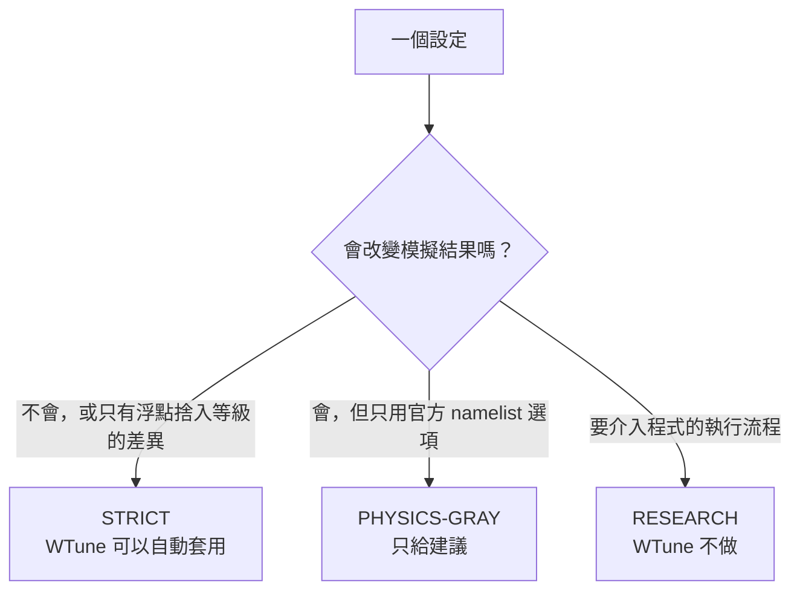

# compliance

```bash
wtune compliance list --compliance strict
```

列出 WTune 可以自動調整的所有設定。這一頁說明分類的規則。

## 前提

WTune **不修改任何 WRF 原始檔**，也不用 `LD_PRELOAD`、連結期的 `--wrap`、PMPI 這類方式介入 `wrf.exe` 的執行。它只動三樣東西：namelist、啟動方式（`mpirun` 的參數）、環境變數。

## 三個類別

WTune 會碰到的每一個設定都屬於下面三類之一。三類不會放在一起排名。



| 類別 | 例子 | WTune 的行為 | 驗證方式 |
|---|---|---|---|
| **STRICT** | 節點數、decomposition、tile 數、OpenMP 執行緒數、rank 擺放方式、I/O 格式 | `wtune tune` 自動搜尋，`wtune run` 自動採用 | 見下一節 |
| **PHYSICS-GRAY** | 換物理方案、`radt`、`cudt`、`time_step`、hydrostatic | 只印建議，不改 namelist | 和參考執行逐欄位比較，由你判斷能否接受 |
| **RESEARCH** | 改變執行流程的任何做法 | 不提供 | — |

## STRICT 不等於逐位元相同

STRICT 的定義是：WRF 原始碼不變、正常編譯、模擬的演算法與物理設定不變。它底下再分兩種：

| 輸出的差異 | 哪些設定 | 驗證方式 |
|---|---|---|
| 逐位元相同 | tile 數、OpenMP 執行緒數、rank 擺放方式等 | `diffwrf` |
| 同一套演算法，浮點捨入可能不同 | `nproc_x`、`nproc_y`、MPI rank 數、MPI 函式庫參數、編譯選項 | 以很緊的欄位容許誤差比較 |

所以改了 decomposition 之後，兩次執行的輸出可能在最後幾個位元不同。這是運算順序改變造成的捨入差異，不是設定被改掉。

`wtune compliance list` 的 `numerics=` 欄位寫明每個設定屬於哪一種（`none` 或 `roundoff`）。

## tune 的 STRICT 保證

`wtune tune` 產生報告之前有一道檢查：把報告改過的每一個 namelist key 和個案原本的 namelist 比對。只要有一個 key 不屬於 STRICT，就直接報 `ComplianceError`，不會產生報告。

量測用的時間窗 key（`run_*`、`start_*`、`end_*`）不在此限：縮短量測窗不會改變完整執行算出來的解。

## 例外：`--cfl-rescue`

`wtune run` 遇到 CFL 或 NaN 失敗時，預設是**停下來**，把建議的 `time_step` 寫在失敗那一段旁邊的 `segment.advice.namelist.input`，不重送任何東西。

只有你事先加上 `--cfl-rescue`，它才會用較小的 `time_step` 把那一段重跑一次，並在報告標記 `physics_gray: true`。

## 執行結果的驗證

比對兩次執行的輸出：

```bash
wtune post compare runs/before/ runs/after/
```

想評估一個會改變結果的設定（例如 `radt`）能不能接受，要另外和一組你已經接受的執行做比較；通過 WTune 的比較**不等於**任何官方認定，這類結果一律標示為未確認。
