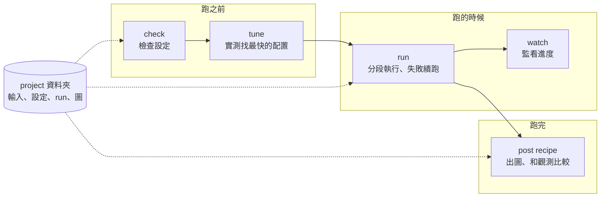

# WTune

WTune 幫你把一個 WRF 個案跑得更快、跑得完、跑完有圖，而且**不改 WRF 原始碼**。

```bash
wtune project init ~/projects/mycase --case /path/to/case_dir
cd ~/projects/mycase
wtune doctor      # 機器和專案準備好了嗎
wtune submit      # 調校 → 執行 → 後處理，一次做完
```

第一次使用先讀 [0. 整體運作](tutorial/overview.md)，再照順序讀「教學」的 1 到 6；整個流程最短的版本在 [submit](tutorial/quickstart.md)。

## 功能



| 階段 | 指令 | 做什麼 | 產出 |
|---|---|---|---|
| 跑之前 | `wtune post preview` | 還沒跑就列出會畫哪些圖，先畫初始場與觀測 | `post/preview/` |
| 跑之前 | `wtune tune` | 在叢集上實際量測，找出最快的節點數、MPI 切法、OpenMP 執行緒數、tile 數 | `tune/<id>/tune_report.json` |
| 跑的時候 | `wtune run` | 把整段模擬切成數個 Slurm job，用 restart 交接；節點故障會自動續跑 | `runs/<id>/` |
| 跑完 | `wtune post recipe` | 依個案類型出一組標準圖，並和觀測資料比較 | `post/<id>/report.html` |

`wtune submit` 就是把這三步依序做完。

## 核心規則

WTune 只會**自動**調整不改變模擬內容的設定：節點數、MPI decomposition（區域切法）、tile 數、OpenMP 執行緒數、I/O 格式。演算法、物理設定、時間步長都維持原樣。

物理方案、`time_step`、垂直層數、nesting 這類會改變答案的設定，WTune **只給建議，不會替你改**。細節在 [compliance](guide/compliance.md)。

## 需求

- 一個已經能跑的 WRF 個案資料夾（`namelist.input`、`wrfinput_d01`、`wrfbdy_d01`）。
- 一個已編好的 WRF（`$WRF_TREE/main/wrf.exe`）。WTune 不負責編 WRF。
- Slurm 叢集。`scc` 與 `f1-arm` 實際跑過完整流程；換機器要準備 `campaign/sites/<site>.sh` 與 [machine](tutorial/project.md#machine) 設定。

下一步：[1. 安裝](tutorial/install.md)。
