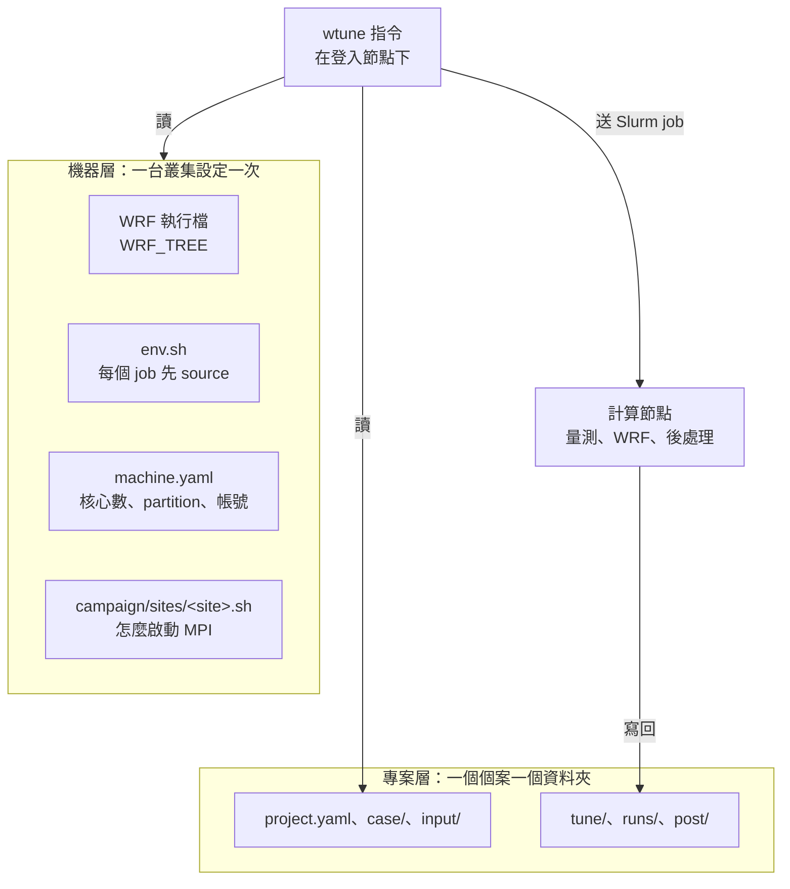
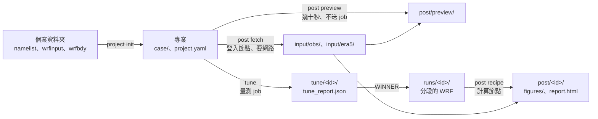
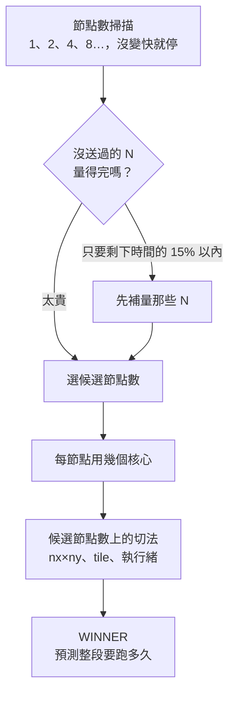

# 0. 整體運作

WTune 接手一個已經能跑的 WRF 個案。它在叢集上實際量測，找出最快的配置，把整段模擬分段跑完，再出圖並和觀測比較。它不改 WRF 原始碼，也不改物理設定。

這頁說明各部分怎麼接起來。每個指令的細節在後面的教學。

## 三層：機器、專案、指令

| 層 | 放什麼 | 多久改一次 |
|---|---|---|
| 機器 | 編好的 WRF、函式庫、`env.sh`、`~/.config/wtune/machine.yaml`、站點檔 | 換機器、換 WRF 執行檔時 |
| 專案 | 個案輸入、設定、每次 tune／run／post 的結果 | 每個個案一個 |
| 指令 | `wtune tune`、`run`、`post`… | 每次使用 |

指令在登入節點上執行，本身只做控制：送 job、輪詢 Slurm、讀結果。重的工作（量測、WRF、後處理）都在計算節點上跑。所以指令要一直開著，等它的 job 跑完；長的指令用 `setsid nohup ... &` 放到背景。

## 一個個案從頭到尾

| 步驟 | 指令 | 在哪裡跑 | 產出 |
|---|---|---|---|
| 建專案 | `wtune project init <dir> --case <個案>` | 登入節點 | `case/`、`project.yaml`、`cases.json` |
| 下載觀測 | `wtune post fetch <name>` | 登入節點（要網路） | `input/obs/<name>/`、`input/era5/` |
| 預分析 | `wtune post preview` | 登入節點 | `post/preview/` |
| 調校 | `wtune tune -O2 ...` | 控制在登入節點，量測在計算節點 | `tune/<id>/tune_report.json` |
| 執行 | `wtune run` | 每段一個 Slurm job | `runs/<id>/` |
| 後處理 | `wtune post recipe --srun` | 計算節點 | `post/<id>/` |

`wtune submit` 依序做「調校 → 執行 → 下載觀測 → 後處理」。已經調校過時加 `--skip-tune`。

## tune：怎麼找出最快的配置

每次量測都是一個短的 WRF：用某個配置跑幾十步，記下每步秒數。一個 Slurm job 量一個節點數，job 名稱是 `sw-<case-id>-n<N>`。tune 依序收斂：

- **`-O0` 到 `-O3`**：決定量多細。`-O2` 是一般情況，見 [tune](tune.md)。
- **`--minutes`**：只算 job 實際在跑的時間。排隊不算。
- **`--max-queue-hours`**：累積排隊時間的上限，預設 6 小時。到了就不再送新的 job，用已經量到最快的節點數交出結果。
- **結果**：寫在 `tune/<id>/tune_report.json`，開頭幾行是摘要。`wtune run` 會自動用最新一份的 WINNER。

## run：怎麼把整段模擬跑完

- 用 WINNER 的節點數、rank 數、切法和執行緒數。
- 第一次執行時，把輸入轉成 ADIOS2 BP 格式，放在 `input/bp/`，之後重複使用。
- 模擬切成數段，每段是一個 Slurm job，段與段之間用 restart 檔交接。節點故障時從上一個 restart 續跑。
- 進度用 `wtune watch runs/<id>` 看。細節見 [run 與 watch](run.md)。

## post：出圖與比較

1. 從 namelist 與輸出判斷個案類型：颱風、對流、地形、雲……可以同時符合好幾種。
2. 每種類型畫一組標準圖，並和 `input/` 裡的觀測比較。
3. 全部的圖集中到 `post/<id>/figures/`，`report.html` 逐張說明它回答什麼問題、資料從哪來。

`wtune post preview` 在跑之前就做第 1 步，列出會畫哪些圖，並先畫出不需要模式就能畫的那些：地形、初始場、觀測。跑完後拿同名的圖來比。細節見 [post](post.md)。

## WTune 會改什麼

| 自動調整（不改變答案） | 只給建議（會改變答案） |
|---|---|
| 節點數、MPI 切法、tile 數、OpenMP 執行緒數、I/O 格式 | 物理方案、`time_step`、垂直層數、巢狀網格 |

細節在 [compliance](../guide/compliance.md)。

## 中途停止

`wtune tune` 目前不處理中斷訊號。殺掉它之後，已送出的 job 要自己用 `scancel` 取消，做法見 [tune](tune.md) 的「中途停止」一節。

下一步：[1. 安裝](install.md)。
