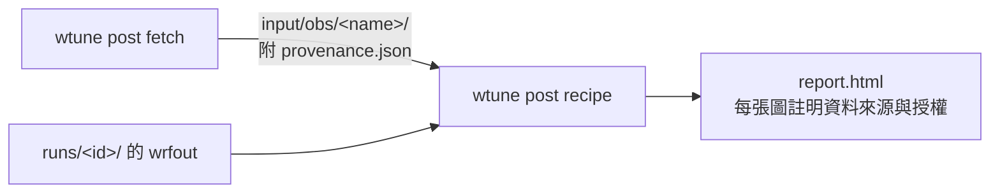

# 6. post

```bash
wtune post recipe --srun
```

在 project 內執行。它讀 `runs/*/` 的輸出，依個案類型畫一組標準圖，和觀測資料比較，全部收進 `post/<id>/report.html`。

所有圖另外集中在 `post/<id>/figures/`，檔名是 `<類型>-<原檔名>`（例如 `tc-track_map.png`、`synoptic-syn_slp_thickness.png`），可以直接整個資料夾瀏覽。這裡是 hard link，不另外佔空間；各類型的子資料夾仍保留圖旁邊的資料檔（csv、dat）。

`wtune post` 底下所有指令都只讀模式輸出、只產生圖和表：不改 namelist，不送模式的 job。

!!! tip "`--srun` 是什麼"
    出圖很吃記憶體和 CPU，不要在登入節點上做。任何 `wtune post` 子指令加上 `--srun`，就會包成一個獨佔計算節點的 job step 來執行（預設上限 120 分鐘，`--srun-minutes N` 可改），並避開 `head` 和專案設定的節點。

各圖組（共同圖、資料產品、每種個案類型、時間序列）彼此獨立，會同時在不同程序裡畫，報告裡的順序不變；颱風追蹤的 `DetectNodes` 也會把時間切成幾段同時跑。程序數預設是 job 可用的 CPU 數，記憶體不夠時用 `WTUNE_POST_WORKERS` 調小（`1` 就是逐組依序畫）。

## 個案類型

`--types auto`（預設）會自動判斷。類型是**多標籤**：同時符合幾種，就把每一種的圖都畫出來。

| 類型 | 自動判斷的條件 | 主要的圖 |
|---|---|---|
| `common` | 一律包含 | 區域與巢狀域地圖 |
| `tc` | 最佳路徑資料顯示風暴在 d01 內（需要 `--storm` 與 `--hurdat2`，或 `--bdeck`） | 路徑、強度誤差、風速半徑 |
| `convection` | 有任一個域 dx ≤ 4 km 且 `cu_physics=0` | 最大回波、CAPE／CIN、上升氣流螺旋度、Skew-T |
| `precip` | 一律包含 | 累積降水，以及對 Stage IV 的比較 |
| `synoptic` | d01 範圍 ≥ 1500 km 或模擬 ≥ 24 小時 | 500 hPa 高度與渦度、海平面氣壓、850 hPa、250 hPa 噴流 |
| `pbl` | `bl_pbl_physics=0` 或 dx ≤ 1 km | 剖面、時間–高度圖、對探空的比較 |
| `terrain` | 地形起伏 ≥ 1000 m 或最高點 ≥ 1500 m | 地形與風場、跨山剖面 |
| `moisture` | 偵測到 precip、convection 或 tc | 可降水量、水氣通量（IVT） |
| `chem` | `chem_opt>0` | 濃度與風場 |
| `climate` | 模擬 ≥ 30 天 | 月平均、季平均、對 ERA5 與 GPCP 的偏差 |

自己指定類型就跳過自動判斷：

```bash
wtune post recipe --types tc,convection --srun
```

## 跑之前先看：preview

```bash
wtune post preview          # 在 project 內；不需要 runs/
```

還沒跑 WRF 就能做，幾秒鐘，不送 job。它用專案裡已有的資料回答兩件事：

還沒跑 `wtune prep real`（沒有 `wrfinput`）時也能用：網域圖改用 `prep wps` 產生的 `geo_em`（有地形），再不然就只用 `namelist.wps`（只有網域框），模擬時段從 `namelist.input` 讀，個案類型則要等 `wrfinput` 才偵測得到。

- **跑完會畫哪些圖**：依 namelist 和 `wrfinput` 偵測個案類型（和 `recipe` 用同一套規則），把每種圖和它回答的問題列在 `post/preview/expected_figures.csv` 與 `preview.html`。
- **大概會長什麼樣**：現在就能畫的圖放在 `post/preview/figures/`——
    - 地形與網格（`common_domain_map.png`）
    - 起始時刻的海平面氣壓與 10 m 風（`synoptic-syn_slp_wind10_f000.png`，來自 `wrfinput`）
    - 颱風個案的最佳路徑（`tc-track_map.png`）
    - 模擬時段的 Stage IV 觀測雨量（`precip-precip_stage4_total.png`）
    - 已下載的 ERA5 500 hPa 高度

- **圖的數值**：每張圖畫的數值另存成 netCDF，放在 `post/preview/data/`，檔名和 `figures/` 裡的圖相同、副檔名換成 `.nc`。例如 `synoptic-syn_slp_wind10_f000.nc` 有 `slp`（hPa）、`u10`、`v10`（m/s）和 2-D 的 `lat`、`lon`；`common_domain_map.nc` 每個 domain 一個 group（`d01`、`d02`…），各有地形 `terrain`。最佳路徑沒有網格，數據是 `tc/best_track.dat`（ATCF 格式）。用 `ncdump -h` 或 xarray 讀即可。

`preview.html` 另外列出 tune 預估的執行時間，每張圖下面也註明數據檔。

這些圖都不是模式結果，而是初始場和觀測：模式中途會算出什麼，跑之前無法知道。跑完後拿 `post/<id>/figures/` 的同名圖（例如兩邊的 `tc-track_map.png`）來比，差異就是模式自己的表現。觀測要先用 `wtune post fetch` 下載，沒下載的那幾張會在「略過」裡說明。

## 時間序列與動畫

```bash
wtune post recipe --every 6h --srun            # 每 6 小時一組完整的圖
wtune post recipe --every 6h --animate --srun  # 另外每個欄位做一支 MP4
wtune post recipe --times 2005082700,2005082712 --srun
```

圖放在 `post/<id>/timeseries/`，檔名像 `slp_d02_f018_2005082718Z.png`：欄位、域、預報時數、有效時間。

## 觀測比較



`wtune submit` 會自動抓 `project.yaml` 裡 `post.fetch` 列的資料。手動抓：

```bash
wtune post fetch --list                 # 有哪些資料集、各自涵蓋的時間
wtune post fetch stage4 --project .
wtune post fetch nexrad --project . --run-dir runs/<id>/
```

| 資料集 | 內容 | 限制 |
|---|---|---|
| `stage4` | NCEP Stage IV 降水 | 2001 年起，僅美國本土 |
| `nexrad` | NEXRAD 雷達體積掃描 | — |
| `mrms` | MRMS 合成回波與降水估計 | 2020-10-14 起 |
| `stations` | ISD-Lite 地面測站 | 點觀測 |
| `igra` | IGRA2 探空 | 00Z 與 12Z |
| `era5`、`era5_monthly` | ERA5 再分析 | — |
| `gpcp_monthly` | GPCP 月降水 | 2.5 度 |
| `bdeck` | NHC ATCF 最佳路徑 b-deck（`project.yaml` 的 `storm:`） | 大西洋與東、中太平洋 |

抓資料要在能連外網的機器上執行，也就是登入節點。在 Slurm job 裡（`--srun`、`wtune submit` 的後處理）不會連網：`tc` 只讀 `bdeck` 抓好的檔或 `--bdeck`，都沒有時改用 HURDAT2；地圖底圖只讀 `bin/fetch-natural-earth.sh` 下載好的 Natural Earth，沒有就不畫海岸線。每個資料集都會寫一份 `provenance.json`（提供者、網址、授權、抓取時間、引用格式）。

比較範圍一律排除模式的側邊界區。降水比對另外限制在 NEXRAD 站 230 km 以內，因為 Stage IV 在外海是 0 而不是缺值。

### agent 找來的觀測

沒有 fetch 模組的資料（美國以外的格點雨量、各國雨量站）可以由 agent 依 [event](event.md) 的流程找來，轉成標準格式 `wtune-obs/1` 放在 `input/obs/<name>/`。`post recipe` 會自動使用通過 `wtune event obs-check` 的資料夾：

| kind | 檔案 | 畫出的圖 |
|---|---|---|
| `gridded_precip` | `precip_YYYYMMDDHH_NNh.nc`（到該時刻為止 NN 小時的累積，`precip` mm） | `precip_agent_*`：和 Stage IV 同樣的 Grid-Stat 四張圖，在該資料集自己的格網上比 |
| `rain_gauges` | `gauges.csv`（`id,lat,lon,elev_m,start_utc,end_utc,precip_mm`） | `precip_gauge_*`：MET Point-Stat 的散布圖和每站偏差地圖 |
| `radar` | `refl_YYYYMMDDHHMM.nc`（`refl` dBZ；無回波填負值，無涵蓋填 NaN） | `conv_radar_*`、`conv_fss`：沒有 MRMS／NEXRAD 時改用它，在模式網格上比 |
| `satellite_ir` | `irtb_YYYYMMDDHHMM.nc`（紅外窗區亮溫 `tb`，K） | `cloud_ir_*`：模式 OLR 換算亮溫對衛星，冷雲頂 ≤240／220／210 K 的分數與 FSS |
| `stations_extra` | `stations_extra.csv`（`id,lat,lon,elev_m,time_utc,var,value`，`var` 是 `gust` m/s 或 `visibility` m） | `stn_gust_*`、`stn_vis_*`：Point-Stat 散布圖與每站偏差地圖 |

所有格點檔都是 1-D `lat`、`lon`（度），時間一律 UTC。WRF 不輸出陣風與能見度，模式端用標準診斷：陣風有 `WSPD10MAX`（`nwp_diagnostics = 1`）就用，否則用 NCEP UPP 的 CALGUST；能見度用 Stoelinga–Warner（1999），模式與觀測都截在 16.1 km。衛星比較的模式值是 OLR 換算的寬頻亮溫，在高雲上比窗區頻道偏暖。

```bash
wtune event obs-check --project .        # 檢查 input/obs/ 下所有 wtune-obs/1 資料夾
```

有 error 的資料夾不會被使用，報告頂端的 notes 會寫出第一個錯誤。`obs-check` 也會對常見的轉換錯誤發出 warning（整個資料夾都沒有超過 1 mm 的雨、大範圍雷達沒有任何缺值、陣風中位數低於 2 m/s 等），這些多半是單位、縮放或雷達範圍沒處理好，要確認後再用。圖下的來源標示取自該資料夾的 `provenance.json`。

## 報告

打開 `post/<id>/report.html`，從上往下看：

1. **頂端的 notes 框**：WTune 繞過了哪些問題（路徑追蹤退回父域、觀測沒涵蓋、離線、缺工具）。
2. **偵測到的類型與依據**，例如 `convection: d02 dx=4 km, cu_physics=0`。
3. **各類型的圖**，每張圖有說明：這張圖回答什麼問題、怎麼讀、常見的誤讀。
4. **缺少的圖**與原因。
5. **資料來源與授權**。

畫不出來的圖不會被默默略過，一定列在「缺少」裡並附原因。

## 其他 subcommand

```bash
wtune post inventory runs/<id>/ --json
wtune post extract runs/<id>/ --vars slp,t2,wspd10 --points "25.4,-74.6,eye" --out points.csv
wtune post plot runs/<id>/ --field slp --overlay wind --out figs/
wtune post sounding runs/<id>/ --point 25.4,-74.6 --time 2005-08-27_00:00:00 --out skewt.png
wtune post compare runs/a/ runs/b/ --vars T2,slp
```

| 指令 | 用途 | 底層工具 |
|---|---|---|
| `inventory` | 有哪些域、時間、變數；有沒有缺 frame | `ncdump`、CDO |
| `extract` | 抽出點位時間序列或區域 netCDF | wrf-python |
| `plot` | 單一欄位的地圖 | wrf-python、cartopy |
| `sounding` | Skew-T 與 CAPE／CIN | MetPy |
| `compare` | 逐欄位比對兩次執行的結果 | WRF 的 `diffwrf` |
| `tc` | 颱風路徑追蹤與誤差 | TempestExtremes、MET |
| `custom` | 執行 `analysis/*.py` 裡你自己的腳本 | — |

!!! note "用 compare 檢查兩次執行的差異"
    ```bash
    wtune post compare runs/before/ runs/after/
    ```
    兩次執行只差在 tile 數、OpenMP 執行緒數或 rank 擺法時，`diffwrf` 應該回報完全相同。改了 decomposition 或 rank 數時，可能出現浮點捨入等級的差異，原因見 [compliance](../guide/compliance.md)。

## custom

`wtune project init` 在 `analysis/` 放了一個範例。每個腳本定義一個 `run(ctx)`：

```python
def run(ctx):
    for run_id, run_dir in ctx.runs():
        domain = ctx.finest_domain(run_dir)
        for time_str, path, timeidx in ctx.list_frame_refs(run_dir, domain=domain):
            ds = ctx.open_wrfout(path)
            ...
    ctx.save_figure(fig, "my_figure.png")
    ctx.save_table("my_table.csv", ["time", "value"], rows)
```

```bash
wtune post custom --srun
```

所有腳本的圖和表會收成一份 HTML。某個腳本丟出例外時只會多一筆錯誤記錄，其他腳本照跑。

`ctx.kit` 是常用的分析工具，不必每次自己寫：`obs_model_panels`（觀測與模擬並排、同一色階；台灣用 CWA 色階）、`box_mean`（箱型區平均）、`match_points`（雨量站對最近格點）、`scores_by_threshold`（ETS、bias；`normalized=True` 改用各自的百分位數當門檻）、`hovmoller`、`track_error`。`ctx.observations("rain_gauges")` 列出通過 obs-check 的觀測，`ctx.rain_focus(run_dir, domain)` 回傳最大降雨核心與高峰時刻。

## 讓 agent 審圖、補圖、寫判讀

自動圖組只是底稿。決策 0078 的流程是：WTune 產生圖與數字，agent（skill `wtune-post`）審每張圖、補這個個案需要的圖、寫分層判讀，最後由 WTune 用程式檢查。

```bash
wtune post recipe                       # post/<id>/，含 figures.json
wtune post brief post/<id>              # post/<id>/brief.json：給 agent 的個案摘要
# agent 寫 post/<id>/review.json、analysis/*.py（再跑 wtune post custom）、post/<id>/assessment.md
wtune post check post/<id>              # 有 error 就 exit 1
```

- `brief.json`：個案類型與網域、各 run、哪些觀測通過檢查、已畫與缺少的圖（附每張圖要回答的問題）、關鍵數字（spin-up 後最大降雨核心與高峰時刻、最低海平面氣壓）。
- `review.json`：每張圖的判定 `ok`、`fix`、`drop`；不是 `ok` 的要寫出問題。
- `assessment.md`：依序有設定、大尺度、目標變數、分數、機制、結論與限制六節；每段至少用 markdown 連結引用一張圖或一個 CSV；引用 CSV 的段落裡的小數，必須在該 CSV 以同樣位數出現。

preview 也走同樣的流程：`wtune post preview` 之後跑 `wtune post brief post/preview`，agent 審 preview 的圖，在 `review.json` 寫出跑完後要畫的圖（`plan`），再跑 `wtune post check post/preview`。每個 `fix` 都要附上修正方式（`action`），共三種：

- `project_set`：用 `wtune project set --post-focus/--cross-section/--post-types/--post-every/--post-times/--post-map-domains/--post-figures-off/--post-figures-on/--post-overlay` 等繪圖旗標調整標準圖（見下一節）。
- `analysis`：交給 `analysis/*.py` 重畫。
- `wtune_defect`：WTune 本身畫錯，回報給使用者。

agent 的完整說明在 repo 根目錄的 `AGENT.md`，裡面也說明了怎麼把任何 agent 或 harness 接到 WTune。`wtune project init` 會在專案寫一份 `AGENTS.md` 指向它；舊專案可以用 `wtune project set --agents-md` 補上。

`project.yaml` 的 `post.focus: [lat_min, lat_max, lon_min, lon_max]` 指定研究區域，也可以用 `wtune project set --post-focus 21.8,25.4,119.9,122.1` 設定。剖面、時高圖、探空和最大回波圖會改在這個區域內 spin-up 後雨量最大的地方取點，並畫在該處降雨高峰的時刻。沒設定時，取點範圍是整個最內層網域（避開邊界）。

### agent 用旗標調整後處理並重畫

agent 看完圖覺得要改，不必手寫程式，用 `wtune project set` 改 `project.yaml` 的 `post` 區塊，再重跑 `wtune post recipe`。`review.json` 的 `project_set` action 可以用同樣的旗標，`wtune post check` 會用 project 自己的解析器試解析，格式錯或圖 id 不存在就報錯。

| 旗標 | project.yaml 鍵 | 作用 |
|---|---|---|
| `--post-times T1,T2` | `post.times` | 指定時間序列圖的時刻（UTC）。接受 `2022-04-05T06`、`2022-04-05T06:00`、WRF 慣用的 `2022-04-05_06:00:00` 與 `2022-04-05 06:00`，存成 `YYYY-MM-DDTHH[:MM]`。**第一個時刻同時決定一次性地圖**（地形、對流、雲、綜觀、水氣 PW/IVT、探空）的時間，取 finest domain 最近的一幀；沒設 `post.times` 時這些圖用雨量高峰時刻，若該 domain 在 spin-up 之後雨量最大的輸出間隔，平均雨率低於 0.1 mm/h（`focus.MIN_PEAK_RATE_MM_H`），視為無雨，改用最後一幀並在報告 note 說明。優先序：`wtune post recipe --times` > `post.times` > `--every`／`post.every`。時刻不在 wrfout 範圍內會報錯並列出可用範圍；範圍內的時刻取最近的一幀。`project set` 有任何旗標格式錯就整筆不寫入，錯誤訊息列出每個有問題的旗標、值與可接受的範例。 |
| `--post-map-domains d01,d03` 或 `all` | `post.map_domains` | 網域配置圖也替列出的巢狀網格畫地形，並多畫一張放大到該網格的地形圖（圖 id `common_domain_map_zoom`，檔名 `common_domain_map_d03.png`）。預設只有 d01。海面（有 `LANDMASK` 用 `LANDMASK == 0`，否則 `HGT <= 0.5 m`）畫淺藍色；小 domain 的經緯度軸至少 3 個刻度，標 °N／°W。 |
| `--post-overlay wind10` | `post.map_overlay` | 在上面的放大圖，以及時間序列的 `t2`、`wspd10` 地圖疊 10 m 風羽（節）；放大圖的時刻是 `post.times` 的第一個，沒有就用一次性地圖的時刻（雨量高峰，無雨則最後一幀）。其他圖不受影響。目前只支援 `wind10`。 |
| `--post-figures-off ID,ID` | `post.figures_off` | 這幾張圖不出現在 `figures.json`、報告和輸出資料夾；id 以 `catalog.json` 為準。 |
| `--post-figures-on ID,ID` | `post.figures_on` | 只驗證 id 並記一則 note；目前沒有預設不畫的圖，所以不會多畫任何東西。 |
| `--post-stations ID,ID`、`--post-station-vars t2,wspd10,wdir10,gust`、`--post-station-method nearest\|bilinear`、`--post-calm-kt 3` | `post.stations`、`post.station_vars`、`post.station_method`、`post.calm_kt` | 測站清單與變數（`t2,td2,wspd10,wdir10,gust,slp`）。設了 `post.stations` 之後，`wtune post recipe` 會在結束前自動做逐站比對：用 `input/obs/` 下第一個通過 obs-check 的 `stations` 資料夾，沒有就只印一則 note；逐站圖登記進 `figures.json`。`wtune post stations --project P` 對沒給的 `--stations/--vars/--method/--calm-kt` 讀同樣的鍵。 |

每個旗標的值是整組取代，`none` 清除該鍵。完整的例子：agent 發現下坡風最強的一刻是 2019-01-30 09 UTC，d03 的地形圖沒畫出來，又覺得 `timeseries_mcape` 沒用。

```bash
wtune project set --post-times 2019-01-30T09 --post-map-domains d01,d03 \
    --post-overlay wind10 --post-figures-off timeseries_mcape
wtune post recipe                       # 重畫：只畫 09 UTC，多出 common_domain_map_d03.png
wtune post check post/<新的 id>         # review.json 的 project_set args 照同樣旗標寫
```

`wtune project info` 會列出非預設的 `post` 鍵。這些旗標改的是選擇（時刻、網格、圖的開關），不改圖本身的畫法；要畫新的圖還是用 `analysis/*.py`。

## 測站逐站比對

有測站觀測（`wtune-obs/1` 的 `stations` 資料夾）時，`wtune post stations` 對每個指定測站、每個包含該站的 domain 各畫一條時間序列，並算 bias 與 RMSE。

```bash
wtune event obs-convert asos sba.csv --out input/obs/asos --dataset "IEM ASOS" \
  --provider "Iowa Environmental Mesonet" --url https://mesonet.agron.iastate.edu \
  --license "public domain" [--station SBA=34.426,-119.84,3]
wtune post stations --run runs/run1 --obs input/obs/asos --stations SBA,IZA,OXR \
  --vars t2,wspd10,wdir10,gust --method nearest --calm-kt 3 --out post/stations
```

`obs-convert asos` 讀 Iowa Environmental Mesonet 的 ASOS CSV（欄位依名稱讀取，缺值 `M`／空白／`null`），°F 轉 °C、knot 轉 m/s；CSV 沒有的站高 `elev_m` 留空，可用 `--station ID=lat,lon,elev` 補。輸出有 `station_series.csv`（逐時配對）、`station_stats.csv`（n、bias、RMSE、格點與站高差）和每個測站與變數一張圖，圖登記在 `figures.json`，`wtune post check` 看得到。

- 模式值取最近格點（`nearest`）或雙線性（`bilinear`）；最外一圈格點不比較。沒有站高修正，站高差記在 `model_hgt_minus_elev_m`。
- 風用 `COSALPHA`／`SINALPHA` 轉成地球座標後再算風速與風向（來向）。
- 觀測與最近的模式輸出時間差在 `--tol-min`（預設 10 分鐘）以內才配對。
- 風向差用環狀差，bias 取環狀差的平均；觀測風速低於 `--calm-kt` 的配對不進風向統計，筆數記在 `n_calm_excluded`。
- 支援 `t2`、`td2`（由 Q2 與 PSFC 算）、`wspd10`、`wdir10`、`gust`；`slp` 尚未支援。陣風的模式值是 `WSPD10MAX`（有寫出時），否則是 UPP 式估計。
- **陣風的樣本有偏**：ASOS 只在真的有陣風時才填 gust 欄（`M` 代表沒有陣風，不是缺值），所以陣風的配對只含有陣風的時刻，bias 與 RMSE 描述的是「有陣風時」的表現，不是全時段（Run 1 的 SBA 只有 n=4、bias −8.03）。`station_stats.csv` 的 `note` 欄對 gust 列寫 `obs only when gusts occur; model gust source = WSPD10MAX|estimated`，逐站圖的 gust 面板標題附 `(gust reports only)`，compare 的 notes 也會列出 n。引用時要帶著 n 與這個限制。
- 設了 `post.stations` 時，`wtune post recipe` 會自動跑這項比對（見上表），結果與逐站圖放在同一個 post 目錄。

教學到這裡結束。接下來可以看 [compliance](../guide/compliance.md)。
