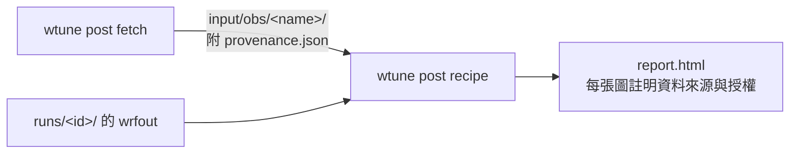

# 6. post

```bash
wtune post recipe --srun
```

在 project 內執行。它讀 `runs/*/` 的輸出，依個案類型畫一組標準圖，和觀測資料比較，全部收進 `post/<id>/report.html`。

`wtune post` 底下所有指令都只讀模式輸出、只產生圖和表：不改 namelist，不送模式的 job。

!!! tip "`--srun` 是什麼"
    出圖很吃記憶體和 CPU，不要在登入節點上做。任何 `wtune post` 子指令加上 `--srun`，就會包成一個獨佔計算節點的 job step 來執行（預設上限 120 分鐘，`--srun-minutes N` 可改），並避開 `head` 和專案設定的節點。

## 個案類型

`--types auto`（預設）會自動判斷。類型是**多標籤**：同時符合幾種，就把每一種的圖都畫出來。

| 類型 | 自動判斷的條件 | 主要的圖 |
|---|---|---|
| `common` | 一律包含 | 區域與巢狀域地圖 |
| `tc` | 最佳路徑資料顯示風暴在 d01 內（需要 `--storm` 與 `--hurdat2`，或 `--bdeck`） | 路徑、強度誤差、風速半徑 |
| `convection` | 有任一個域 dx ≤ 4 km 且 `cu_physics=0` | 最大回波、CAPE／CIN、上升氣流螺旋度、Skew-T |
| `precip` | 一律包含 | 累積降水，以及對 Stage IV 的比較 |
| `synoptic` | d01 範圍 ≥ 1500 km 或模擬 ≥ 24 小時 | 500 hPa 高度與渦度、海平面氣壓、850 hPa、250 hPa 噴流 |
| `pbl` | `bl_pbl_physics=0` 或 dx ≤ 1 km | 剖面、時間–高度圖、對探空的比較 |
| `terrain` | 地形起伏 ≥ 1000 m 或最高點 ≥ 1500 m | 地形與風場、跨山剖面 |
| `moisture` | 偵測到 precip、convection 或 tc | 可降水量、水氣通量（IVT） |
| `chem` | `chem_opt>0` | 濃度與風場 |
| `climate` | 模擬 ≥ 30 天 | 月平均、季平均、對 ERA5 與 GPCP 的偏差 |

自己指定類型就跳過自動判斷：

```bash
wtune post recipe --types tc,convection --srun
```

## 時間序列與動畫

```bash
wtune post recipe --every 6h --srun            # 每 6 小時一組完整的圖
wtune post recipe --every 6h --animate --srun  # 另外每個欄位做一支 MP4
wtune post recipe --times 2005082700,2005082712 --srun
```

圖放在 `post/<id>/timeseries/`，檔名像 `slp_d02_f018_2005082718Z.png`：欄位、域、預報時數、有效時間。

## 觀測比較



`wtune submit` 會自動抓 `project.yaml` 裡 `post.fetch` 列的資料。手動抓：

```bash
wtune post fetch --list                 # 有哪些資料集、各自涵蓋的時間
wtune post fetch stage4 --project .
wtune post fetch nexrad --project . --run-dir runs/<id>/
```

| 資料集 | 內容 | 限制 |
|---|---|---|
| `stage4` | NCEP Stage IV 降水 | 2001 年起，僅美國本土 |
| `nexrad` | NEXRAD 雷達體積掃描 | — |
| `mrms` | MRMS 合成回波與降水估計 | 2020-10-14 起 |
| `stations` | ISD-Lite 地面測站 | 點觀測 |
| `igra` | IGRA2 探空 | 00Z 與 12Z |
| `era5`、`era5_monthly` | ERA5 再分析 | — |
| `gpcp_monthly` | GPCP 月降水 | 2.5 度 |

抓資料要在能連外網的機器上執行。每個資料集都會寫一份 `provenance.json`（提供者、網址、授權、抓取時間、引用格式）。

比較範圍一律排除模式的側邊界區。降水比對另外限制在 NEXRAD 站 230 km 以內，因為 Stage IV 在外海是 0 而不是缺值。

## 報告

打開 `post/<id>/report.html`，從上往下看：

1. **頂端的 notes 框**：WTune 繞過了哪些問題（路徑追蹤退回父域、觀測沒涵蓋、離線、缺工具）。
2. **偵測到的類型與依據**，例如 `convection: d02 dx=4 km, cu_physics=0`。
3. **各類型的圖**，每張圖有說明：這張圖回答什麼問題、怎麼讀、常見的誤讀。
4. **缺少的圖**與原因。
5. **資料來源與授權**。

畫不出來的圖不會被默默略過，一定列在「缺少」裡並附原因。

## 其他 subcommand

```bash
wtune post inventory runs/<id>/ --json
wtune post extract runs/<id>/ --vars slp,t2,wspd10 --points "25.4,-74.6,eye" --out points.csv
wtune post plot runs/<id>/ --field slp --overlay wind --out figs/
wtune post sounding runs/<id>/ --point 25.4,-74.6 --time 2005-08-27_00:00:00 --out skewt.png
wtune post compare runs/a/ runs/b/ --vars T2,slp
```

| 指令 | 用途 | 底層工具 |
|---|---|---|
| `inventory` | 有哪些域、時間、變數；有沒有缺 frame | `ncdump`、CDO |
| `extract` | 抽出點位時間序列或區域 netCDF | wrf-python |
| `plot` | 單一欄位的地圖 | wrf-python、cartopy |
| `sounding` | Skew-T 與 CAPE／CIN | MetPy |
| `compare` | 逐欄位比對兩次執行的結果 | WRF 的 `diffwrf` |
| `tc` | 颱風路徑追蹤與誤差 | TempestExtremes、MET |
| `custom` | 執行 `analysis/*.py` 裡你自己的腳本 | — |

!!! note "用 compare 檢查兩次執行的差異"
    ```bash
    wtune post compare runs/before/ runs/after/
    ```
    兩次執行只差在 tile 數、OpenMP 執行緒數或 rank 擺法時，`diffwrf` 應該回報完全相同。改了 decomposition 或 rank 數時，可能出現浮點捨入等級的差異，原因見 [compliance](../guide/compliance.md)。

## custom

`wtune project init` 在 `analysis/` 放了一個範例。每個腳本定義一個 `run(ctx)`：

```python
def run(ctx):
    for run_id, run_dir in ctx.runs():
        domain = ctx.finest_domain(run_dir)
        for time_str, path, timeidx in ctx.list_frame_refs(run_dir, domain=domain):
            ds = ctx.open_wrfout(path)
            ...
    ctx.save_figure(fig, "my_figure.png")
    ctx.save_table("my_table.csv", ["time", "value"], rows)
```

```bash
wtune post custom --srun
```

所有腳本的圖和表會收成一份 HTML。某個腳本丟出例外時只會多一筆錯誤記錄，其他腳本照跑。

教學到這裡結束。接下來可以看 [compliance](../guide/compliance.md)。
