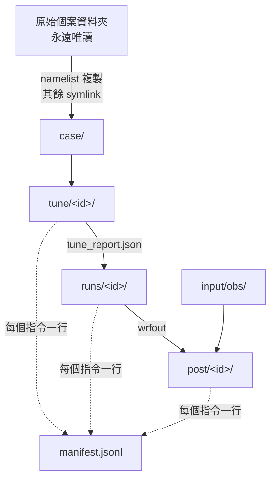

# 3. project

```bash
wtune project info
```

一個 project 資料夾收納同一個個案的輸入、設定、每次執行和所有圖。上面這個指令印出它目前的內容。

## 目錄結構

```text
mycase/
  project.yaml      個案、站點、要避開的節點、機器規格、後處理預設值、風暴資訊
  cases.json        這個專案的個案登記（wtune tune 用）
  case/             namelist 的副本，其餘檔案是 symlink
  input/            驅動資料與觀測（era5/、obs/<name>/、bp/）
  tune/<id>/        wtune tune 的輸出
  predict/<id>/     wtune predict-rebuild 的輸出
  runs/<id>/        wtune run 的輸出
  post/<id>/        wtune post 的輸出（圖、表、report.html）
  analysis/         你自己的分析腳本（wtune post custom 會執行）
  manifest.jsonl    每個 wtune 指令一行記錄
```



!!! note "原始個案不會被動到"
    `case/` 裡的 `namelist.input` 是副本，可以自由編輯。`wrfinput`、`wrfbdy`、`met_em` 等是 symlink，WTune 不會開啟原始資料夾來寫入。

## project 的搜尋順序

依序是：

1. 指令上的 `--project DIR`
2. 環境變數 `$WTUNE_PROJECT`
3. 從目前目錄往上找 `project.yaml`

所以最省事的做法是 `cd` 進 project 再下指令。在 project 內，`--out` 預設是對應子目錄下的 `<id>/`，要處理的 run 預設是 `runs/*/`。

在 project 之外，`--out` 和 run 目錄都必須自己給。

## project.yaml

`wtune project init` 產生的內容：

```yaml
name: mycase
created: '2026-10-12T03:13:05Z'
case:
  source_dir: /path/to/case_dir
  id: mycase-b8e603
site: scc
exclude_nodes:
- work1
post:
  types: auto
  every: 6h
  fetch:
  - era5
  - igra
  - stage4
  - stations
storm: null
```

| 欄位 | 作用 |
|---|---|
| `case.id` | `wtune tune` 用的個案代號 |
| `site` | 機器的標籤，只是記錄，不影響執行 |
| `exclude_nodes` | 這個專案所有 job 都避開的節點（另外一律避開 `machine.login_nodes`） |
| `post.types` | 後處理的個案類型，`auto` 代表自動判斷 |
| `post.every` | 每隔多久出一組完整的圖 |
| `post.fetch` | `wtune submit` 會自動去抓的觀測資料 |
| `storm` | 颱風代號與 HURDAT2 檔，颱風個案才需要 |

## machine

叢集的規格。內建值是 scc 的，`wtune project init` 不會寫這個區塊。換一台機器時才加，只寫要改的 key：

```yaml
machine:
  cores_per_node: 64       # 一個計算節點的硬體核心數，內建 72
  max_nodes: 20            # 一個 job 最多用幾個節點，內建 13
  partition: batch         # Slurm partition，內建 compute
  login_nodes: [login1]    # 不送工作的節點，內建 [head]；[] 代表沒有
  account: myproject       # Slurm 的計畫帳號，內建不指定
  hardware_id: mybox       # 這種節點在量測紀錄裡的名字，內建 scc-gh200
  numa_per_node: 2         # 一個節點有幾個 NUMA 區，內建 1
  calibration: /path/to/mybox.json   # 這台機器的校準檔，內建用 scc 的
```

| key | 影響 |
|---|---|
| `cores_per_node` | 每個 job 向 Slurm 要的 `--ntasks-per-node`。配置的每節點 rank 數 × 執行緒數不能超過它 |
| `max_nodes` | `wtune tune` 搜尋節點數的上限。`--max-nodes` 和 `wtune.yaml` 的 `budget.max_nodes` 只能再往下調 |
| `partition` | 每個 `sbatch` 和收尾轉檔 `srun` 用的 partition |
| `login_nodes` | 每個 job 一律排除的節點，和 `exclude_nodes` 合併 |
| `account` | 每個 `sbatch`、`srun` 加上 `--account=`。依計畫計費的機器不給會被拒絕 |
| `hardware_id` | 每筆量測都記這個名字，預測模型用它分辨機器。WTune 內建認得 `scc-gh200`、`f1-spr-icpnq`、`f1-spr-icpnp`；其他機器要自己取一個名字 |
| `numa_per_node` | 決定可以試哪些 OpenMP 執行緒數：只試能整除「每個 NUMA 區核心數」的值，執行緒才不會跨區 |
| `calibration` | `wtune tune`、`wtune run`、`wtune check` 估算執行時間用的校準檔，由 `wtune calibrate fit` 產生。要寫絕對路徑 |

新機器至少要給 `cores_per_node`、`hardware_id`、`numa_per_node`。沿用 `scc-gh200` 這個名字卻改了核心數會直接報錯，避免別台機器的量測混進 scc 的紀錄。

`cores_per_node` 是節點的大小，不是每節點實際用幾核。實際用幾核由配置決定，`wtune tune` 會自己試少用幾核的配置。

優先順序：


`tune`、`run`、`post`、`submit` 都讀這裡，所以設一次就夠。打錯 key 或給了不合理的值會直接報錯，例如：

```text
error: project.yaml machine.cores_per_node: 'many' must be a positive integer
```

!!! note "目前只在 scc 上驗證過"
    這個區塊讓節點大小、節點數、partition、登入節點、計畫帳號、硬體描述和校準檔可以換。MPI 的啟動方式和 WRF 的路徑仍由 `campaign/sites/scc.sh` 決定，換機器時那個檔也要準備一份。

## project set

不用手改 YAML，用 `wtune project set`：

```bash
wtune project set --exclude-nodes work1,work7
wtune project set --cores-per-node 64 --max-nodes 20
wtune project set --partition batch --login-nodes login1 --account myproject
wtune project set --hardware-id mybox --numa-per-node 2 --calibration ~/mybox.json
wtune project set --post-every 1d
wtune project set --post-types tc,convection
wtune project set --post-fetch era5,stage4
wtune project set --storm AL122005 --hurdat2 hurdat2-1851-2024.txt
```

清除一個設定：`--exclude-nodes ''`、`--post-every none`、`--post-fetch none`。`--login-nodes ''` 代表這台機器沒有要排除的登入節點。要讓 `machine` 的某個 key 回到內建值，把那一行從 `project.yaml` 刪掉。

比較舊的 project 沒有登記個案時：

```bash
wtune project set --register-case
```

## manifest.jsonl

每個 `wtune` 指令在這裡留一行：時間、WTune 版本、完整的 argv、主要輸入檔的路徑與 sha256（小於 50 MB 的檔案）、輸出目錄、exit code。

```bash
tail -3 manifest.jsonl
```

下一步：[4. tune](tune.md)。
