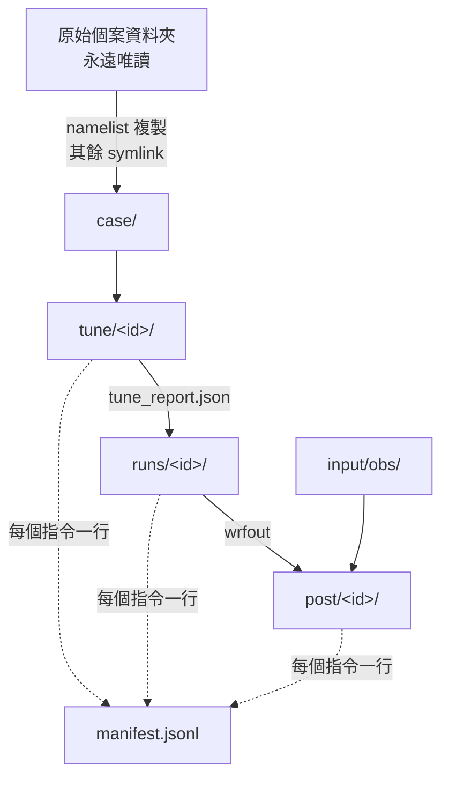

# 3. Project 資料夾

```bash
wtune project info
```

一個 project 資料夾收納同一個個案的輸入、設定、每次執行和所有圖。上面這個指令印出它目前的內容。

## 長什麼樣子

```text
mycase/
  project.yaml      個案、站點、要避開的節點、後處理預設值、風暴資訊
  cases.json        這個專案的個案登記（wtune tune 用）
  case/             namelist 的副本，其餘檔案是 symlink
  input/            驅動資料與觀測（era5/、obs/<name>/、bp/）
  tune/<id>/        wtune tune 的輸出
  predict/<id>/     wtune predict-rebuild 的輸出
  runs/<id>/        wtune run 的輸出
  post/<id>/        wtune post 的輸出（圖、表、report.html）
  analysis/         你自己的分析腳本（wtune post custom 會執行）
  manifest.jsonl    每個 wtune 指令一行記錄
```



!!! note "原始個案不會被動到"
    `case/` 裡的 `namelist.input` 是副本，可以自由編輯。`wrfinput`、`wrfbdy`、`met_em` 等是 symlink，WTune 不會開啟原始資料夾來寫入。

## WTune 怎麼找到 project

依序是：

1. 指令上的 `--project DIR`
2. 環境變數 `$WTUNE_PROJECT`
3. 從目前目錄往上找 `project.yaml`

所以最省事的做法是 `cd` 進 project 再下指令。在 project 內，`--out` 預設是對應子目錄下的 `<id>/`，要處理的 run 預設是 `runs/*/`。

在 project 之外，`--out` 和 run 目錄都必須自己給。

## project.yaml

`wtune project init` 產生的內容：

```yaml
name: mycase
created: '2026-10-12T03:13:05Z'
case:
  source_dir: /path/to/case_dir
  id: mycase-b8e603
site: scc
exclude_nodes:
- work1
post:
  types: auto
  every: 6h
  fetch:
  - era5
  - igra
  - stage4
  - stations
storm: null
```

| 欄位 | 作用 |
|---|---|
| `case.id` | `wtune tune` 用的個案代號 |
| `exclude_nodes` | 這個專案所有 job 都避開的節點（另外一律避開 `head`） |
| `post.types` | 後處理的個案類型，`auto` 代表自動判斷 |
| `post.every` | 每隔多久出一組完整的圖 |
| `post.fetch` | `wtune submit` 會自動去抓的觀測資料 |
| `storm` | 颱風代號與 HURDAT2 檔，颱風個案才需要 |

## 修改設定

不用手改 YAML，用 `wtune project set`：

```bash
wtune project set --exclude-nodes work1,work7
wtune project set --post-every 1d
wtune project set --post-types tc,convection
wtune project set --post-fetch era5,stage4
wtune project set --storm AL122005 --hurdat2 hurdat2-1851-2024.txt
```

清除一個設定：`--exclude-nodes ''`、`--post-every none`、`--post-fetch none`。

比較舊的 project 沒有登記個案時：

```bash
wtune project set --register-case
```

## manifest.jsonl：事後查得到做過什麼

每個 `wtune` 指令在這裡留一行：時間、WTune 版本、完整的 argv、主要輸入檔的路徑與 sha256（小於 50 MB 的檔案）、輸出目錄、exit code。

```bash
tail -3 manifest.jsonl
```

下一步：[4. 調校](tune.md)。
