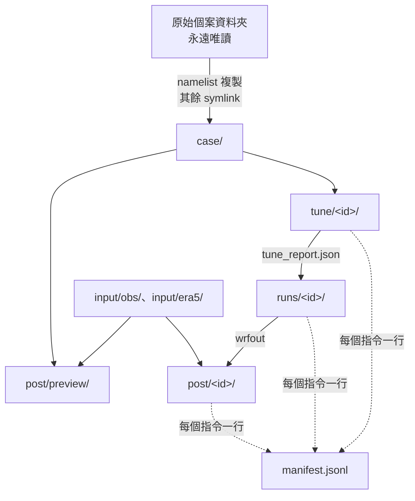

# 3. project

```bash
wtune project info
```

一個 project 資料夾收納同一個個案的輸入、設定、每次執行和所有圖。上面這個指令印出它目前的內容。

## 目錄結構

```text
mycase/
  project.yaml        個案、站點、機器覆寫、後處理預設、風暴資訊（用 wtune project set 改）
  cases.json          個案登記（wtune tune 用）
  wtune.yaml          （選用）這個專案自己的調校限制
  manifest.jsonl      每個 wtune 指令一行：時間、版本、指令、輸入的 sha256、輸出、exit code
  case/               namelist.input 是副本，可以改；wrfinput、wrfbdy 等是 symlink，唯讀
  input/
    bp/               run 用的 ADIOS2 輸入（第一次 run 時轉好）
    bp-cache/         tune 用的 ADIOS2 輸入
    era5/             wtune post fetch era5
    obs/<name>/       stage4、igra、stations、mrms…，各附 provenance.json
  tune/<id>/          一次 tune
    tune_report.json    WINNER、摘要、量過的所有配置
    nodes-n<N>/         節點數掃描每個 job 的輸出
    cores-n<N>-c<C>/    每節點核心數的量測
    n<N>/               候選節點數上的切法量測
  runs/<id>/          一次 run
    run_report.json     用了哪個配置、每段的 job 與結果
    seg_<k>/            第 k 段的 WRF 執行目錄與輸出
  post/<id>/          一次後處理
    report.html         全部的圖加說明
    figures/            全部的圖集中在這裡（<類型>-<檔名>）
    <類型>/              圖旁邊的資料檔（csv、追蹤結果…）
  post/preview/       wtune post preview，每次覆寫
  predict/<id>/       wtune predict-rebuild
  analysis/           你自己的分析腳本（wtune post custom 會執行）
  _nc_cache/          後處理把 BP 轉成 netCDF 的快取，可以刪，會重建
```

`<id>` 是開始時間（UTC），例如 `20261018165842`。哪個 id 是哪個指令產生的，查 `manifest.jsonl`。



!!! note "原始個案不會被動到"
    `case/` 裡的 `namelist.input` 是副本，可以自由編輯。`wrfinput`、`wrfbdy`、`met_em` 等是 symlink，WTune 不會開啟原始資料夾來寫入。

### 沒有 wrfinput：用 prep 產生

個案沒有 `wrfinput`、`wrfbdy`，或要重新產生時，在專案裡依序下（投影取自 `namelist.wps`，沒有時取自 `wrfinput_d01`）：

1. `wtune prep wps`：在登入節點下載整段時間的 GFS／FNL／CFSR（依日期自動選，`--forcing` 可指定），再送一個 job 跑 geogrid、ungrib、metgrid。
2. `wtune prep real`：送一個 job 跑 real.exe，把新的 `wrfinput_d<NN>`、`wrfbdy_d01` 連結進 `case/`。`case/` 已經有這些檔時要加 `--replace`。

工作目錄是 `input/prep/`，job 的 log 在 `input/prep/run-<jobid>.out`。需要先 `source` 機器的 `env.sh`（要有 `WPS_DIR` 與 `WRF_TREE`）。Ctrl-C 會取消正在跑的 job。目前不接受自備的 GRIB 檔。

!!! warning "下載量與下載中斷"
    - 下載量跟 namelist 的視窗長度成正比：GFS 0.25° 每 3 小時一個檔，每檔約 0.22 GB，48 小時約 3.7 GB，120 小時約 9 GB。只是要測流程時，先把 `run_hours` 改短。
    - 資料來源偶爾會在下載途中停住。重試 3 次仍缺檔時，`prep wps` 會印 `still missing after 3 attempts` 並結束，這時還沒有送出任何 job。原樣再下一次 `wtune prep wps` 即可：已下載的檔會跳過，下到一半的檔會接著下。

### 只有 restart 檔的個案

個案沒有 `wrfinput_d01`、只有 restart 檔時，`project init` 這樣處理：

1. 保留 namelist 起始時間那一組 `wrfrst_d<NN>_<start>`（每個 domain 一個），其他時間的 restart 照舊略過。
2. 在 `case/namelist.input` 副本裡設 `restart = .true.`。原始資料夾不會被改。
3. `cases.json` 記下 `restart: true`、起始時間與格式（netCDF 是 2，BP 目錄是 14）。

之後 `wtune tune` 的每個量測都從這組 restart 起跑，`wtune run` 的第一段也是。仍然需要 `wrfbdy_d01`。namelist 的 `start_*` 要等於 restart 檔的時間，不符時 `wtune run` 會列出缺哪些檔。

restart 個案的 `wtune tune` 會在 plan 階段印 `no projection source`：預測整段時間需要重建個案，而重建要 `wrfinput_d01` 或 `namelist.wps` 才知道網格投影。這不影響量測和 WINNER，只是少了那一段預測；要有它，把個案的 `namelist.wps` 放進來源資料夾再 `project init`。

### 不在專案裡的東西

| 東西 | 位置 | 為什麼在外面 |
|---|---|---|
| WRF 執行檔、函式庫 | `WRF_TREE`、`env.sh` 指的地方 | 每個專案共用 |
| 機器設定 | `~/.config/wtune/machine.yaml` | 每個專案共用 |
| tune 每個量測 job 的原始紀錄（ledger CSV）與 WRF 工作目錄 | `~/wtune-runs/campaign/` | 目前寫死在這裡；整理過的結果在 `tune/<id>/tune_report.json` |
| 專案外執行的 tune 的 ADIOS2 輸入 | `~/wtune-runs/bp-cache/` | 只有不在專案裡跑 tune 時才用 |

### 怎麼整理

- **一個個案一個專案**。同一批實驗的專案放在同一個上層資料夾，例如 `~/wtune-projects/<批次>/<個案>/`。整批的腳本、總表、筆記放在上層，不要放進個案專案。
- **自己的 log 不要放在專案根目錄**，放到 `logs/`（WTune 不會碰它）。根目錄只留 WTune 的檔案，`project info` 才看得清楚。
- **一定要留**：`project.yaml`、`case/`、`manifest.jsonl`、每個 `tune/<id>/tune_report.json`、`runs/<id>/run_report.json`、`post/<id>/report.html` 與 `figures/`。這些是結果和來源的紀錄，佔的空間很小。
- **需要空間時可以刪**：
    - `_nc_cache/` 和 `input/bp-cache/`：會重建。
    - 舊的 `runs/<id>/seg_<k>/` 輸出：先確認那次的 post 做完。
    - 舊的 `post/<id>/<類型>/` 資料檔。
  
  刪之前先查 `manifest.jsonl`，確認那個 id 是哪次指令產生的。
- **換了 WRF 執行檔或編譯旗標，要重新 tune**：`tune/<id>/` 的數字只對當時的 `wrf.exe` 成立。

## project 的搜尋順序

依序是：

1. 指令上的 `--project DIR`
2. 環境變數 `$WTUNE_PROJECT`
3. 從目前目錄往上找 `project.yaml`

所以最省事的做法是 `cd` 進 project 再下指令。在 project 內，`--out` 預設是對應子目錄下的 `<id>/`，要處理的 run 預設是 `runs/*/`。

在 project 之外，`--out` 和 run 目錄都必須自己給。

## project.yaml

`wtune project init` 產生的內容：

```yaml
name: mycase
created: '2026-10-12T03:13:05Z'
case:
  source_dir: /path/to/case_dir
  id: mycase-b8e603
site: scc
exclude_nodes:
- work1
post:
  types: auto
  every: 6h
  fetch:
  - era5
  - igra
  - stage4
  - stations
storm: null
```

| 欄位 | 作用 |
|---|---|
| `case.id` | `wtune tune` 用的個案代號 |
| `site` | 機器的標籤，只是記錄，不影響執行 |
| `exclude_nodes` | 這個專案所有 job 都避開的節點（另外一律避開 `machine.login_nodes`） |
| `post.types` | 後處理的個案類型，`auto` 代表自動判斷 |
| `post.every` | 每隔多久出一組完整的圖 |
| `post.fetch` | `wtune submit` 會自動去抓的觀測資料 |
| `storm` | 颱風代號與 HURDAT2 檔，颱風個案才需要 |

## machine

叢集的規格。內建值是 scc 的，`wtune project init` 不會寫這個區塊。換一台機器時才加，只寫要改的 key：

```yaml
machine:
  cores_per_node: 64       # 一個計算節點的硬體核心數，內建 72
  max_nodes: 20            # 一個 job 最多用幾個節點，內建 13
  partition: batch         # Slurm partition，可列多個依序試，內建 compute
  login_nodes: [login1]    # 不送工作的節點，內建 [head]；[] 代表沒有
  account: myproject       # Slurm 的計畫帳號，內建不指定
  hardware_id: mybox       # 這種節點在量測紀錄裡的名字，內建 scc-gh200
  numa_per_node: 2         # 一個節點有幾個 NUMA 區，內建 1
  calibration: /path/to/mybox.json   # 這台機器的校準檔，內建用 scc 的
  site: mybox              # 用 campaign/sites/mybox.sh 啟動工作，內建 scc
  env_source: ~/mybox-env.sh         # 每個工作先 source 的環境腳本，內建 $HOME/wtune-scc/env.sh
  wrf_tree: ~/wrf/WRF      # WRF 的根目錄，底下有 main/wrf.exe
  geog: /data/WPS_GEOG     # WPS 的靜態地理資料
  max_hours: 8             # partition 允許的最長工作時數，內建 0（不設上限）
  max_omp: 1               # 每個 rank 最多幾個執行緒；WRF 沒有 OpenMP 時設 1，內建 0（不限）
  node_preflight: false    # 調校前不要對每個節點各送一個探測工作，內建 true
  node_memory_gib: 218     # 一個計算節點的記憶體；內建 0（不知道，不檢查）
  copy_probe_inputs: false # 探測直接讀共用的 BP 輸入快取，不各自複製；內建 true
  measured:                # 這台機器自己量到的數字，取代內建的 scc 值
    noise_frac: 0.05
    restart_write_s_adios2: 2.4
```

| key | 影響 |
|---|---|
| `cores_per_node` | 每個 job 向 Slurm 要的 `--ntasks-per-node`。配置的每節點 rank 數 × 執行緒數不能超過它 |
| `max_nodes` | `wtune tune` 搜尋節點數的上限。`--max-nodes` 和 `wtune.yaml` 的 `budget.max_nodes` 只能再往下調 |
| `partition` | 每個 `sbatch` 和收尾轉檔 `srun` 用的 partition。可以列多個（`[arm144, arm576, arm1440]` 或 `arm144,arm576,arm1440`）：`sbatch` 被拒（例如節點數不合這個 partition、超過每人送出上限）就換下一個，全部被拒才報錯，錯誤訊息列出每個 partition 的原因。`srun` 和寫出的 sbatch 檔只用第一個，所以第一個要收單節點工作 |
| `login_nodes` | 每個 job 一律排除的節點，和 `exclude_nodes` 合併 |
| `account` | 每個 `sbatch`、`srun` 加上 `--account=`。依計畫計費的機器不給會被拒絕 |
| `hardware_id` | 每筆量測都記這個名字，預測模型用它分辨機器。WTune 內建認得 `scc-gh200`、`f1-spr-icpnq`、`f1-spr-icpnp`；其他機器要自己取一個名字 |
| `numa_per_node` | 決定可以試哪些 OpenMP 執行緒數：只試能整除「每個 NUMA 區核心數」的值，執行緒才不會跨區 |
| `calibration` | `wtune tune`、`wtune run`、`wtune check` 估算執行時間用的校準檔，由 `wtune calibrate fit` 產生。要寫絕對路徑 |
| `site` | 選用哪一份 `campaign/sites/<site>.sh`（MPI 怎麼啟動、節點怎麼清理、OpenMP 用哪一種執行期函式庫）和 `campaign/cases.<site>.json`。那個檔不存在時 `wtune tune` 會直接報錯 |
| `env_source` | 每個工作開頭 source 的腳本，負責載入編譯器、MPI 和函式庫 |
| `wrf_tree` | 等同環境變數 `WRF_TREE` |
| `geog` | 等同環境變數 `WPS_GEOG`，重建個案時 geogrid 會用到 |
| `max_hours` | 設了之後，`wtune run` 會把整段模擬切成每段都跑得完的長度，探測與重建工作的時限也不會超過它。不設就和以前一樣 |
| `max_omp` | WRF 是沒有 OpenMP 的編譯（dmpar）時設 1：調校從節點掃描的基準組態開始就只用單執行緒，不會留一半核心閒置。不設就和以前一樣 |
| `node_preflight` | 內建會在調校前對 partition 裡每個節點各送一個 1 分鐘的 `srun`，找出不能用的節點。排程器限制每人可送出的工作數時（例如上限 12 個而節點有 40 個），多出來的探測會被拒絕並被當成節點有問題，所以要設成 `false`（`--node-preflight off`） |
| `node_memory_gib` | 調校前先估每個配置每節點要多少記憶體，放不下的不送；第一個成功探測的 MaxRSS 會校正後面的估計。用 `scontrol show node <節點> \| grep RealMemory`（MB）換算 |
| `copy_probe_inputs` | 內建每個探測作業各自複製一份 BP 輸入，避開 scc NFS 多人同時開檔卡住的問題。沒有 reflink 時是整份複製，一波幾個作業就是好幾份；在有配額的檔案系統（例如 f1-arm 的 100 G home2）設成 `false`。副本在作業結束後一律刪除 |
| `measured` | 見下方「measured」 |

新機器至少要給 `cores_per_node`、`hardware_id`、`numa_per_node`。沿用 `scc-gh200` 這個名字卻改了核心數會直接報錯，避免別台機器的量測混進 scc 的紀錄。

`cores_per_node` 是節點的大小，不是每節點實際用幾核。實際用幾核由配置決定，`wtune tune` 會自己試少用幾核的配置。

優先順序：


### measured

沒有實測資料時，WTune 用一組在 scc 上量到的數字來估時間、判斷兩個配置誰快。換機器後這些數字不一定準，量到自己的值就寫進 `measured`，只寫要換的：

```bash
wtune project set --measured noise_frac=0.05 --measured init_s=60
```

| 名稱 | 內建值 | 意義 |
|---|---|---|
| `noise_frac` | 0.03 | 同一個配置重複量測的誤差。差距小於它就視為一樣快，節點搜尋也用它決定要不要早停 |
| `anchor_drift_max` | 0.01 | 同一個探測工作頭尾兩次基準量測允許的漂移 |
| `startup_s` | 120 | 一次執行的啟動時間，第一輪量到之前先用這個 |
| `s_per_step` | 10 | 完全沒有資料時假設的每步秒數 |
| `init_s` | 120 | 一段模擬的初始化時間 |
| `restart_io_s` | 300 | 讀或寫一次 restart |
| `history_frame_s` | 30 | 一個 domain 寫一張輸出 |
| `radiation_factor` | 1.5 | 估每步時間時替輻射步留的倍數 |
| `io_factor` | 2.0 | 建議時限涵蓋實測 I/O 的幾倍 |
| `rebuild_s` | 180 | 重建一個時間點的輸入 |
| `r_rad_default`、`r_rad_day_night_ratio`、`ranking_r_rad` | 5.0、1.87、3.93 | 輻射步相對一般步的成本 |
| `probe_noise_measured_pct`、`_extrapolated_pct`、`_rsl_pct`、`_fallback_pct` | 3、15、5、50 | 預測區間的寬度（%），依每步時間的來源而定 |
| `cold_start_band` | 0.25 | 沒有重建點時預測的 ± 範圍 |
| `restart_write_s_netcdf`、`restart_read_s_netcdf` | 324、120 | conus25 大小的 restart，netCDF |
| `restart_write_s_adios2`、`restart_read_s_adios2` | 1.05、2.3 | 同上，ADIOS2 |
| `history_write_s_netcdf`、`history_write_s_adios2` | 300.5、0.042 | 輸出寫入的基準（各自的基準網格見 `wtune/io_model.py`） |
| `boundary_s_netcdf`、`boundary_s_adios2` | 0.31、0.0216 | 一次側邊界更新 |
| `aux4_s_netcdf`、`aux4_s_adios2` | 0.164、0.033 | 一次 `wrflowinp` 讀取 |
| `iofields_call_ms` | 0.9 | 解析一次 iofields |
| `probe_restart_read_s_adios2`、`probe_restart_read_s_netcdf` | 30、120 | 探測工作讀共用 restart |
| `vec_kv` | 50 | `wtune calc` 成本模型裡寬 patch 的向量化增益 |
| `mem_bytes_per_cell` | 1600 | 記憶體預估：每個 3D 格點的位元組數（isc21 在 f1-arm 量的） |
| `mem_gib_per_rank` | 0.94 | 記憶體預估：每個 MPI rank 的固定用量（物理參數化的查表、程式本身、MPI 緩衝區） |

名稱打錯會直接報錯並列出所有可用的名稱。

### 使用者設定檔

機器的規格每個專案都一樣，所以可以只寫一次，放在家目錄：

```bash
wtune project set --user --cores-per-node 144 --partition arm144,arm576,arm1440 --account myproject
```

這會寫進 `~/.config/wtune/machine.yaml`，內容和上面的 `machine:` 區塊相同，只是少一層縮排：

```yaml
cores_per_node: 144
partition: arm144,arm576,arm1440
account: myproject
```

這台機器上的每個專案、以及在專案外下的指令都會讀它。要換位置就設環境變數 `WTUNE_MACHINE_FILE`。專案的 `machine:` 只需要寫和這份不同的地方。

`tune`、`run`、`post`、`submit` 都讀這裡，所以設一次就夠。打錯 key 或給了不合理的值會直接報錯，例如：

```text
error: project.yaml machine.cores_per_node: 'many' must be a positive integer
```

!!! note "實際跑過的機器"
    scc 與 f1-arm 都跑過完整流程（tune、run、post）。MPI 的啟動方式和節點清理寫在 `campaign/sites/<site>.sh`，換機器時要準備一份，再把 `site` 指過去。

## project set

不用手改 YAML，用 `wtune project set`：

```bash
wtune project set --exclude-nodes work1,work7
wtune project set --cores-per-node 64 --max-nodes 20
wtune project set --partition batch --login-nodes login1 --account myproject
wtune project set --hardware-id mybox --numa-per-node 2 --calibration ~/mybox.json
wtune project set --site mybox --env-source ~/mybox-env.sh --wrf-tree ~/wrf/WRF --geog /data/WPS_GEOG
wtune project set --max-hours 8 --measured noise_frac=0.05
wtune project set --user --partition batch      # 寫進使用者設定檔，不動這個專案
wtune project set --post-every 1d
wtune project set --post-types tc,convection
wtune project set --post-fetch era5,stage4
wtune project set --storm AL122005 --hurdat2 hurdat2-1851-2024.txt
```

清除一個設定：`--exclude-nodes ''`、`--post-every none`、`--post-fetch none`。`--login-nodes ''` 代表這台機器沒有要排除的登入節點。要讓 `machine` 的某個 key 回到內建值，把那一行從 `project.yaml` 刪掉。

比較舊的 project 沒有登記個案時：

```bash
wtune project set --register-case
```

## 專案自己的調校設定

專案資料夾裡如果有 `wtune.yaml`，`wtune submit` 會把它當成 `wtune tune --config`。只寫要限制的項目即可，其餘用內建值。例如只想試 1 和 2 個執行緒：

```yaml
search:
  omp: [1, 2]
```

`search` 的限制不會套到節點掃描的基準組態。整台機器的 WRF 都沒有 OpenMP 時，用 `machine` 的 `max_omp: 1`。

## manifest.jsonl

每個 `wtune` 指令在這裡留一行：時間、WTune 版本、完整的 argv、主要輸入檔的路徑與 sha256（小於 50 MB 的檔案）、輸出目錄、exit code。

```bash
tail -3 manifest.jsonl
```

下一步：[4. tune](tune.md)。
