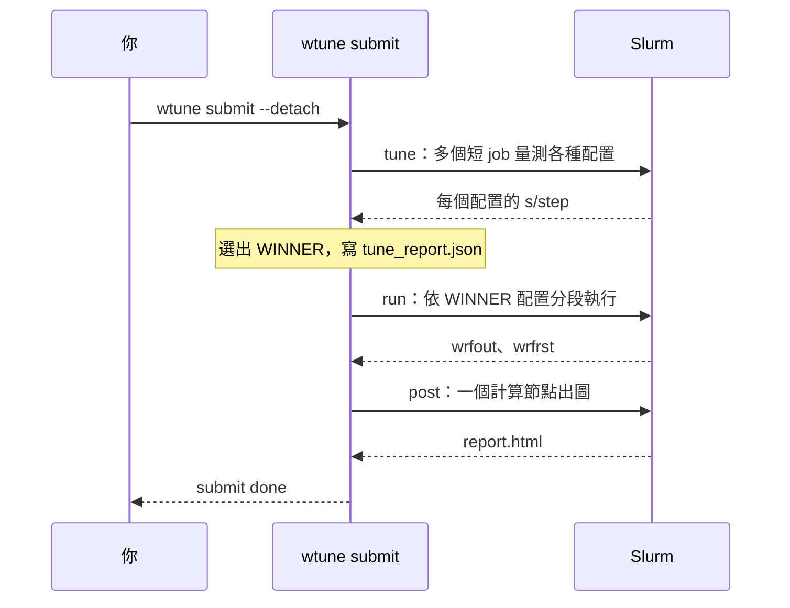

# 2. 第一次跑完整流程

```bash
wtune project init ~/projects/mycase --case /path/to/case_dir --exclude-nodes work1
cd ~/projects/mycase
wtune doctor
wtune submit --dry-run
wtune submit --detach
```

五個指令，從個案資料夾到 `report.html`。下面逐步說明每一步會看到什麼。

## 步驟 1：建立 project

```bash
wtune project init ~/projects/mycase --case /path/to/case_dir --exclude-nodes work1
```

- `--case` 是你原本的 WRF 個案資料夾。它**永遠只被讀取**：namelist 被複製到 `case/`，其餘檔案以 symlink 連過來。
- `--exclude-nodes` 是這個專案所有 job 都要避開的節點（登入節點 `head` 一律會被避開，不用寫）。
- 這一步同時把個案註冊進 `<project>/cases.json`，`wtune tune` 才認得它。

颱風個案多給兩個旗標，後處理才會畫路徑比較：

```bash
wtune project init ~/projects/katrina --case /path/to/katrina_case \
    --storm AL122005 --hurdat2 hurdat2-1851-2024.txt
```

## 步驟 2：檢查

```bash
cd ~/projects/mycase
wtune doctor
```

沒有 `FAIL` 才往下走。專案相關的幾行長這樣：

```text
OK    project: /home/you/projects/mycase
OK    case registered for tune: mycase-b8e603
OK    jobs exclude: head,work1
OK    post defaults: --types auto --every 6h
OK    no tune report yet (wtune tune, or wtune submit)
```

## 步驟 3：先看它打算做什麼

```bash
wtune submit --dry-run
```

只印出三個步驟的完整指令，不送任何 job：

```text
tune  bin/wtune tune -O2 --project <project> --out <project>/tune/<id>
run   bin/wtune run --project <project> --out <project>/runs/<id> --tune-report <project>/tune/<id>/tune_report.json
post  bin/wtune post recipe <project>/runs/<id> --project <project> --out <project>/post/<id> --srun
```

三個輸出共用同一個 `<id>`（UTC 時間戳），所以 `tune/<id>/`、`runs/<id>/`、`post/<id>/` 是同一次提交。

## 步驟 4：送出

```bash
wtune submit --detach
```

`--detach` 讓它在你登出之後繼續跑，並印出記錄檔與監看指令：

```text
submit running in the background (pid 12345)
  log:   <project>/submit-<id>.log
  watch: wtune watch <project>/runs/<id>
```



任何一步失敗就停下來，並指出已有的輸出在哪裡：

```text
=== submit stopped: run exited 1 (outputs so far under */<id>) ===
```

抓觀測資料的步驟例外：失敗只會印一行說明並繼續，報告裡會寫出缺了什麼。

## 步驟 5：看結果

```bash
wtune watch runs/<id>          # 執行中：進度與剩餘時間
tail -f submit-<id>.log        # 整個流程的記錄
```

完成時記錄檔最後一行是：

```text
=== submit done: tune/<id> runs/<id> post/<id> ===
```

打開 `post/<id>/report.html` 就是成果。

!!! example "實際跑過的例子"
    `sc26p1` 個案在 scc 上（2026-10-11）：`wtune submit` 以 `-O2` 調校後選出

    ```text
    WINNER:    N=5 c/n=48 ranks=80 omp=3 8x10 tiles=3 0.0482 s/step
    ```

    意思是 5 個節點、每節點用 48 顆核心、共 80 個 MPI rank、每個 rank 3 條執行緒、區域切成 8×10、每個 patch 3 個 tile，量到每步 0.0482 秒。接著以這個配置完成正式執行，後處理產生 228 張圖。

## 常用變化

| 想做的事 | 指令 |
|---|---|
| 調校做得更省或更徹底 | `wtune submit -O1`、`wtune submit -O3`（預設 `-O2`） |
| 已經調校過，直接跑 | `wtune submit --skip-tune` |
| 只要跑，不要出圖 | `wtune submit --no-post` |
| 一步一步自己來 | `wtune tune -O2`，然後 `wtune run`，然後 `wtune post recipe --srun` |

下一步：[3. Project 資料夾](project.md)。
