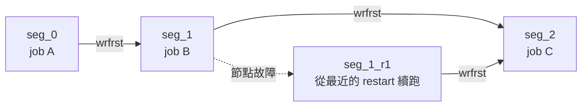
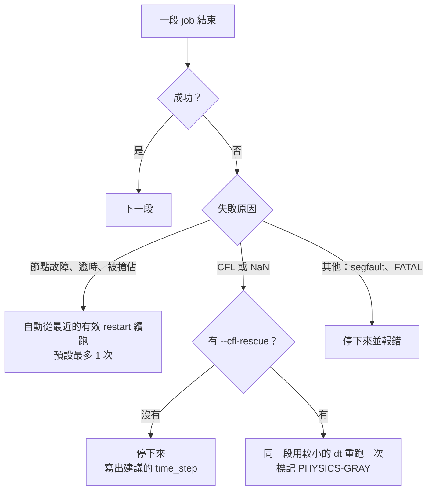

# 5. run 與 watch

```bash
wtune run --dry-run     # 先看會怎麼切
wtune run               # 送出
```

在 project 內執行。它會採用最新的 `tune/*/tune_report.json` 裡的 WINNER 配置，把整段模擬送進 Slurm，輸出放在 `runs/<id>/`。

## 分段執行

一個很長的 job 容易撞到時間上限，中途節點故障也會全部重來。`wtune run` 把模擬切成數段，每段是一個獨立的 Slurm job，段與段之間用 restart 檔交接。



```bash
wtune run --wall-limit 04:00:00        # 每個 job 最多 4 小時，WTune 自己決定切幾段
wtune run --segment-minutes 180        # 每段固定 180 分鐘的模擬時間
```

兩個都不給就是一段跑完。

!!! note "分段不改變結果"
    每一段都寫在同一個 restart 間隔的格點上，歷史輸出的時間點不會因為分段而偏移。實測：`dorian2019` 的 30 + 30 分鐘 restart 接力和一次跑完相比，d01 與 d02 各 202 個變數逐位元相同。

## 手動指定配置

不想用 tune 的結果時：

```bash
wtune run --nodes 4 --nx 16 --ny 28 --numtiles 4 --omp 2
```

`--nodes`、`--nx`、`--ny` 三個要嘛來自 tune 報告，要嘛全部自己給。指定某一份報告：`--tune-report tune/<id>/tune_report.json`。

## 失敗處理



| 情況 | WTune 的行為 | 相關旗標 |
|---|---|---|
| 節點故障、逾時、被搶佔 | 從最近一個有效的 restart 自動續跑 | `--resume N`（預設 1，0 關閉） |
| 個案自己沒寫 restart | 自動補上檢查點 | `--checkpoint-minutes M`（預設 `auto`） |
| 執行中卡住：`rsl.error.0000` 很久沒有新內容（例如磁碟或配額寫滿時 WRF＋ADIOS2 會停住而不是報錯） | 取消該段 job、標為 `stalled` 並停下來，不重送 | `--stall-minutes M`（預設 20，0 關閉） |
| CFL 或 NaN | **停下來**，寫出建議的 `time_step` 與 `segment.advice.namelist.input`，不重送 | — |
| CFL 或 NaN，且你事先授權 | 同一段以約 0.75 倍的 `time_step` 重跑一次，之後的段回到原本的值 | `--cfl-rescue` |
| 其他錯誤 | 停下來並報錯，不會默默重試 | — |

!!! warning "`--cfl-rescue` 會改變結果"
    縮小 `time_step` 會改變數值解，所以用了它的 run 會在報告裡標記 `physics_gray: true`。這是 WTune 唯一會替你改「影響結果的設定」的情況，而且要你明確加上旗標才會發生。

`runs/<id>/run_report.json` 在每一段結束後都會重寫，記錄每次嘗試的結果。

## I/O 格式

預設所有 I/O 都走 ADIOS2（`io_form 14`）：歷史輸出、restart、輸入、邊界條件，以及個案自己開的 `auxhistN` 輸出（例如 isc21 的驗證輸出：scc 上 18 張從 162.5 秒降到 3.37 秒）。個案原本的 netCDF 輸入會轉換一次，放在 `<project>/input/bp/` 重複使用。

ADIOS2 的輸出是 BP 目錄。要交 netCDF 檔時，用 `wtune convert bp2nc <BP 目錄> --out <資料夾>` 轉回；數值與 WRF 直接寫的 netCDF 逐位元相同，只有字串屬性前後的空白會被去掉（例如 `MemoryOrder` 的 `'XY '` 變成 `'XY'`）。

要保留個案自己的 `io_form_*` 設定：`--io netcdf`（舊路徑，會印 WARNING）。

`--sidecar`：job 執行期間，用 WRF 沒用到的核心驗證每組 restart，並把寫完的歷史輸出轉成 netCDF 放進後處理的快取。

`--compress-history`：在 `--sidecar` 之上，每張轉好的 netCDF（zlib，約小 4 倍，無損）先和原本的 BP 逐變數比對，相同才放到 BP 的位置並刪掉 BP；後處理直接讀它，不再另存一份快取。WRF 用滿所有核心時，轉檔共用最後一顆核心、優先度最低。WTune 自己加的 restart，執行中每個資料夾只留最新一組驗證過的（續跑只用最新那組），整個 run 成功後全部刪掉；個案自己要的 restart 不動。WRF 本身的 ADIOS2 壓縮一律關閉（原版 WRF 4.8 在那條路徑上有緩衝區溢位）。

## 從 restart 起跑

namelist 是 `restart = .true.` 時，第一段從個案自己的 `wrfrst_d<NN>_<start>` 起跑，不需要 `wrfinput`。`io_form_restart` 依 restart 檔的格式自動選：netCDF 檔用 2，BP 目錄用 14，因為 WRF 讀寫 restart 用同一個設定。整理方式見 [project](project.md) 的「只有 restart 檔的個案」。

## 中途停止

`wtune run` 在前景跑時按 **Ctrl-C**，在背景跑時在專案裡下 **`wtune stop`**。它在下一次輪詢時（`--poll-interval`，預設 60 秒）依序：

1. 取消正在跑的那一段 job，之後的段不再送出。
2. `run_report.json` 的 `status` 寫成 `stopped`，`error` 寫明是哪一段、哪個 job 被取消。
3. 以結束碼 130 結束。

已經跑完的段留在 `runs/<id>/seg_*/`。再按一次 Ctrl-C 會立刻結束、不取消 job，這時下 `wtune stop` 取消它留下的 job。

!!! warning "`wtune stop` 停的是整個專案"
    不帶參數時，`wtune stop` 會停掉目前目錄所屬專案裡所有在跑的 tune 和 run。只想停其中一個，把它的目錄當參數，例如 `wtune stop runs/<id>` 或 `wtune stop tune/<id>`。在別的專案目錄下指令，不會碰到這個專案。

## watch

```bash
wtune watch runs/<id>              # 每 60 秒更新
wtune watch runs/<id> --once       # 只印一次
```

`watch` 完全唯讀：只讀 `namelist.input` 和 `rsl.error.0000`／`rsl.out.0000`，不寫檔、不送訊號。它顯示進度、剩餘時間（計算與寫檔分開列），以及這些警告：

| 警告 | 意思 | exit status |
|---|---|---|
| `HANG_INIT` | 初始化之後很久沒有出現 d01 的 Timing 行（預設 600 秒） | 2 |
| `HANG` | 執行中途停止推進 | 2 |
| `NEST_STOPPED`、`NEST_END_EARLY` | 巢狀域停了，或比預期早結束 | 2 |
| `FAILED` | 執行失敗 | 3 |

有時間預測檔時，加上 `--prediction predict/<id>/pred_rebuild.json`，剩餘時間會改用預測曲線乘上目前的實際與預測比值。

下一步：[6. post](post.md)。
