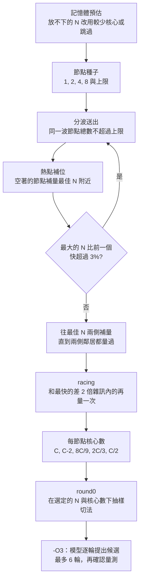

# 4. tune

```bash
wtune tune -O2
```

在 project 內執行。它會送出一批短的 Slurm job，實際量測不同配置的每步耗時（s/step），選出最快的，寫成 `tune/<id>/tune_report.json`。

## 搜尋目標

同一個個案、同一份 namelist，下面這些怎麼配都不會改變演算法和物理設定，但速度可以差很多：

| 項目 | 報告裡的欄位 | 意思 |
|---|---|---|
| 節點數 | `N` | 用幾個節點 |
| 每節點核心數 | `c/n` | 每個節點實際用幾顆核心，其餘閒置 |
| MPI rank 數 | `ranks` | 總共幾個 MPI 行程 |
| OpenMP 執行緒數 | `omp` | 每個 rank 幾條執行緒 |
| decomposition | `nx x ny` | 區域在 x、y 方向各切成幾塊 |
| tile 數 | `tiles` | 每個 patch 再分成幾個 tile |


每節點不一定要把核心用滿：有時少用幾顆核心反而比較快，所以 `c/n` 也是搜尋的一個維度。

## 等級 -O0 到 -O3

| 等級 | 做什麼 | 什麼時候用 |
|---|---|---|
| `-O0` | 不送 job：用模型估計時間，用代理指標挑配置 | 只想先看個大概 |
| `-O1` | 一輪量測，節點數取 1、2、4、8 與可用的最大值 | 短的個案 |
| `-O2` | `-O1` 加上：往最佳節點數兩側補量、每節點核心數、在選定的節點數上抽樣量測切法 | 一般情況（`wtune submit` 的預設） |
| `-O3` | `-O2` 加上：保留兩個節點數、所有合法的 rank × 執行緒、切法、tile 數、由模型逐輪提出候選，最後前幾名重複量測確認 | 很長的正式執行，調校成本攤得掉 |

直接下 `wtune tune` 不帶等級時是 `-O3`。

開始之前，WTune 會先印出**每個等級估計要花多久**，再開始送 job。

```bash
wtune tune -O2 --minutes 90        # 加一個硬上限：整個調校最多 90 分鐘
wtune tune -O3 --stop-if-short     # 整段模擬比調校還短時，自動降到做得完的等級
```

有 `--minutes` 時，`-O2` 量完第一輪切法後，會用實測的啟動時間和每步秒數算出剩下的時間還能量幾個設定，一輪一輪補量到上限為止（留一個重複量測的時間）。不需要預測點的個案，預測階段的時間也給切法搜尋。

!!! note "排隊時間不算在預算裡"
    `--minutes` 只計算量測本身。累積的排隊等待另有上限 `--max-queue-hours`（預設 6 小時），超過就停下來回報。

## 採樣點怎麼選



1. **記憶體預估**：每節點記憶體 ≈ 每格點位元組 × 每節點格點數 ＋ 每個 rank 的固定用量 × 每節點 rank 數。設了 `machine.node_memory_gib` 才會檢查。放不下的 N 先改用較少的每節點核心數，還是放不下才跳過。最小的 N 可能放不下時，種子從最大的 N 開始量：它最不會 OOM，量到的 MaxRSS 又能校正其餘的預估。有 MaxRSS 之前只跳過預估超過節點記憶體 1.3 倍的，之後超過 95% 就跳過；某個 N 被 OOM 砍掉時，節點數不更多、每節點 rank 不更少的組合都不再送。
2. **節點種子**：1、2、4、8……與節點上限。每個種子量一次基準組態（用滿核心、最少執行緒、最接近正方形的切法），量 `probe.sweep_reps` 次（預設 1）。
3. **分波**：同一波的作業同時跑，節點總數不超過上限，整波結束才送下一波。
4. **熱點補位**：一波沒用滿的節點，補量還沒量過、離目前最佳 N 最近的節點數；第一波還沒有量測，就補預估最快的。只補預估不會比這一波最長作業更久的，所以這一波不會變長，但會多用節點時數。
5. **提前停止**：只看種子。最大的 N 沒有比前一個快超過 3%，就不送更大的 N（從最大的 N 開始量時不適用）。
6. **往兩側補量**：最佳 N 是「比最快值慢不到 3% 的 N 裡節點最少的」。在它左右各補一個最近的合法 N；最佳 N 換了就繼續往外走，兩側鄰居都量過才停。鄰居慢超過 3% 或探測失敗時會停在那裡，曲線不是單峰時可能漏掉更遠的 N；要每個都量就用 `node_seeds: all`。
7. **racing**：每個點只量 1 次時，和最快的差在 2 倍雜訊（6%）以內的點，最多 3 個，再量一次，合併後才決定。差距更大的不再量。
8. **每節點核心數**：在選定的 N 試 5 種核心數，取最快的；差 3% 以內取核心多的。同樣做 racing。
9. **round0**：在選定的 N 與核心數下，量基準組態加上分層抽樣的切法（rank × 執行緒、nx × ny、tile 數），每組 1 次。`-O2` 沒有確認量測，所以和最快的差 2 倍雜訊內的切法會在同一個作業裡再量一次，冠軍就是這裡最快的。
10. **`-O3` 的逐輪搜尋**：每輪由模型（其他個案的量測加上這個個案已量的）提出一批候選，平均分給空著的節點同時量測。最快的領先第二名超過 3% 且這一輪沒找到更快的，或用掉 75% 的時間，就停止並進入確認量測（前幾名各量 2 次）。

3% 是量測重複性（`machine.measured.noise_frac`），換機器時可以在 [machine](project.md#machine) 區塊改。

### 每個探測量幾步

| 探測 | 步數 |
|---|---|
| 節點數、每節點核心數 | 約等於「啟動時間 ÷ 每步時間」，限制在 `probe.sweep_steps`（預設 10 到 40） |
| round0、逐輪搜尋、確認量測 | `probe.steps`；`auto` 是 max(30, 輻射間隔步數 + 10)，保證包含一次輻射步 |

每步很便宜的個案取 40 步：多跑幾步幾乎不花時間，而這種個案每步的抖動比較大。每步很貴的個案取 10 步：在 scc 與 f1-arm 約 1900 個探測的逐步時間裡，每步 2 秒以上時，只用 10 步的中位數和整段的差 p90 是 0.5–1.6%，每步很快的個案則要 2–5%。第 1 步含初始化與輻射，一律不算。`probe.steps` 設成固定的數字時，掃描也用那個步數。

## 用 wtune.yaml 調整採樣

| key | 預設 | 作用 |
|---|---|---|
| `budget.max_nodes` | 機器的上限 | 節點數搜尋的上限，也是同一波的節點總數上限 |
| `budget.node_seeds` | `geometric` | `all`：每個合法的節點數都量，不提前停止 |
| `budget.hotspot_fill` | `true` | `false`：不補位，節點時數最少 |
| `budget.sweep_budget_frac` | `0.4` | 節點掃描最多用掉 `minutes` 的比例，用完就不送更大的 N |
| `budget.node_objective` | `time` | `time`：最快（3% 內取節點少的）；`cost`：節點時數最少；`knee`：效率還在 0.7 以上的最大 N |
| `budget.node_finalists` | `2` | `-O3` 保留幾個節點數走完後面的搜尋；`-O2` 固定 1 個 |
| `probe.steps` | `auto` | round0 之後每個探測的步數 |
| `probe.sweep_steps` | `[10, 40]` | 節點與核心數掃描的步數範圍；`null` 表示和 `probe.steps` 一樣 |
| `probe.sweep_reps` | `1` | 節點與核心數掃描每個點量幾次；1 表示接近最快的才再量一次，2 表示每個點都量 2 次 |
| `probe.confirm_reps` | `2` | `-O3` 確認量測的重複次數 |

例一：每個節點數都量一次，例如收集對照用的完整資料。

```yaml
budget:
  minutes: 600
  node_seeds: all
  sweep_budget_frac: 1.0
```

例二：依節點時數計費的機器，少用節點時數。

```yaml
budget:
  minutes: 30
  hotspot_fill: false
probe:
  sweep_steps: [10, 20]
```

例三：每步很快、想要更穩的中位數。

```yaml
probe:
  sweep_steps: [40, 60]
```

存成 `wtune.yaml` 後：

```bash
wtune config validate wtune.yaml
wtune tune -O2 --config wtune.yaml
```

指令列也有對應的旗標，會蓋過檔案裡的值：`--node-seeds all`、`--hotspot-fill off`、`--sweep-budget-frac 1.0`、`--steps 30`（固定步數，掃描也跟著用）。

## 節點檢查

調校前 WTune 會檢查每個節點：`sinfo` 的狀態，加上每個節點一個 1 分鐘的 `srun` 探測（家目錄、個案目錄、WTune 原始碼、`wrf.exe` 是否都讀得到）。沒通過的節點會從所有 job 排除，可用節點數也跟著下修。

要跳過這個檢查：`--no-node-preflight`。

## 報告

最前面是最多 5 行的摘要（也存在 `tune_report.json` 的 `summary`）：

```text
=== summary ===
best:     N=4 c/n=128 512 ranks x 1 threads 16x32 tiles=1: 4.1282 s/step (2 runs)
run:      predicted 15:12 for the whole simulation (t0)
margin:   1.7% ahead of N=4 c/n=144 576 ranks x 1 threads 24x24 tiles=1 -> within noise: either is fine (noise 3%)
not run:  N=13 early stop; N=1-3 memory
tuning:   running 28:00, queue 10:00 (not counted)
```

| 行 | 意思 |
|---|---|
| `best` | 要用的配置與它的 s/step |
| `run` | 用這個配置跑整段模擬的預測時間 |
| `margin` | 和第二名差多少；在雜訊內就表示兩個都可以 |
| `not run` | 沒量的節點數與原因：`memory` 放不下、`early stop` 多加節點沒變快、`budget` 時間不夠、`failed` 作業沒量到、`not measured` 離最佳值太遠 |
| `tuning` | 調校花的量測時間；排隊時間另列，不算在內 |

（數字是示意。）完整的結果接在後面，先找這幾行：

```text
--- measured layouts (37; best first; the full table is in tune_report.json node_selection.layouts) ---
   N   c/n  ranks  omp   nx x ny tiles    median_s  spread  reps  source
   5    48     80    3      8x10     3      0.0482    0.4%     2  ...
 ...
WINNER:    N=5 c/n=48 ranks=80 omp=3 8x10 tiles=3 0.0482 s/step
RUNNER-UP: N=...
winner vs runner-up: 1.2% apart -> NOT distinguishable from noise: either is fine (noise floor 3%)
```

（表格列數、第二名與差距的數字是示意；`WINNER` 那一行是 `sc26p1` 在 scc 上的實測結果。）

| 行 | 怎麼讀 |
|---|---|
| `WINNER` | 選中的配置。`wtune run` 會自動採用它 |
| `RUNNER-UP` | 第二名 |
| `winner vs runner-up` | 兩者差距有沒有超過量測雜訊。寫 `NOT distinguishable from noise` 時，兩個都可以用 |
| `NOT TRIED` | 沒有量測的配置，依原因分組 |
| `not run N=...` | 被跳過的節點數與原因（例如預算用完） |

!!! warning "dirty node"
    看到這一行時，這次的排名不可信：

    ```text
    WARNING: the winner's number comes from a dirty node (...); the ranking may be wrong -- clean the node and tune again
    ```

    意思是量測時那個節點上有別的行程在吃 CPU（常見原因是先前被砍的 job 留下的 `wrf.exe`）。清掉之後重新調校。

## 節點數

預設的目標是「最快」。想省資源時改目標：

```bash
wtune tune --node-objective time                         # 最快；雜訊範圍內取節點最少的（預設）
wtune tune --node-objective cost --deadline-minutes 240  # 在 240 分鐘內跑完的前提下，node-hours 最少
wtune tune --node-objective knee --min-efficiency 0.7    # 平行效率仍有 0.7 以上的最大節點數
```

固定節點數、不搜尋：

```bash
wtune tune --nodes 4
```

## 不更動的項目

調校只改上面那六項。報告產生前有一道檢查：把報告改過的每個 namelist key 和個案原本的 namelist 比對，只要有一個不屬於 STRICT 類別（見 [compliance](../guide/compliance.md)）就直接報錯。

加上 `--physics-advice`（僅 `-O3`）會另外跑一段物理方案的建議，那一段只產生建議，不會套用。

下一步：[5. run 與 watch](run.md)。
